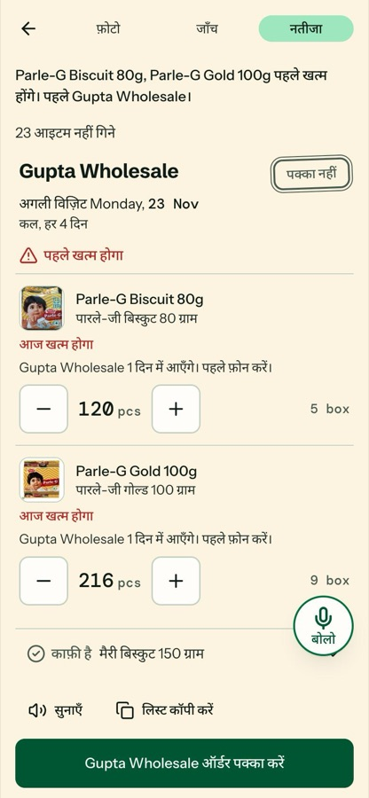
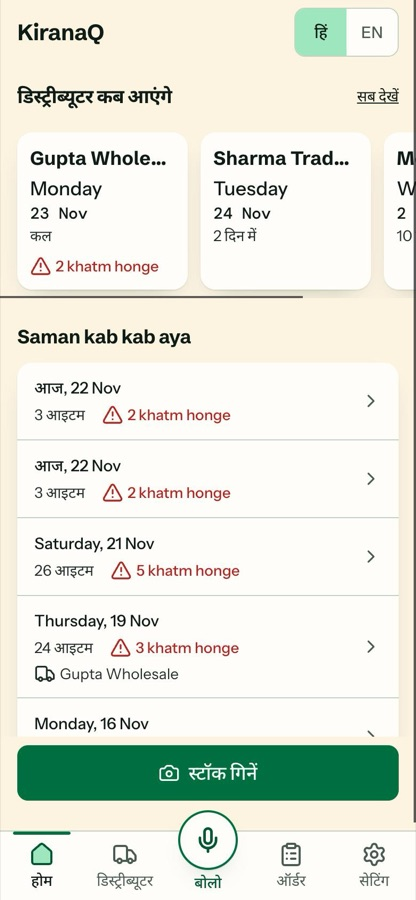
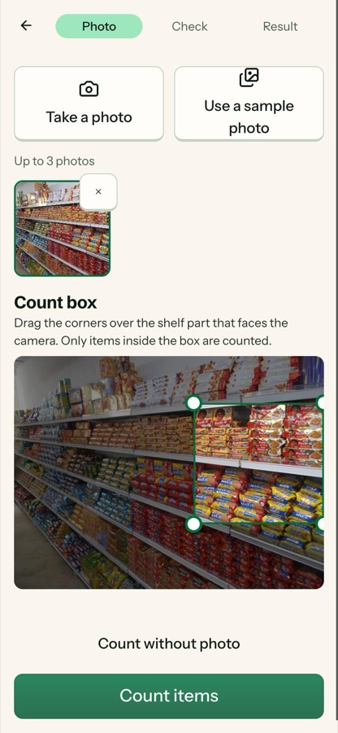
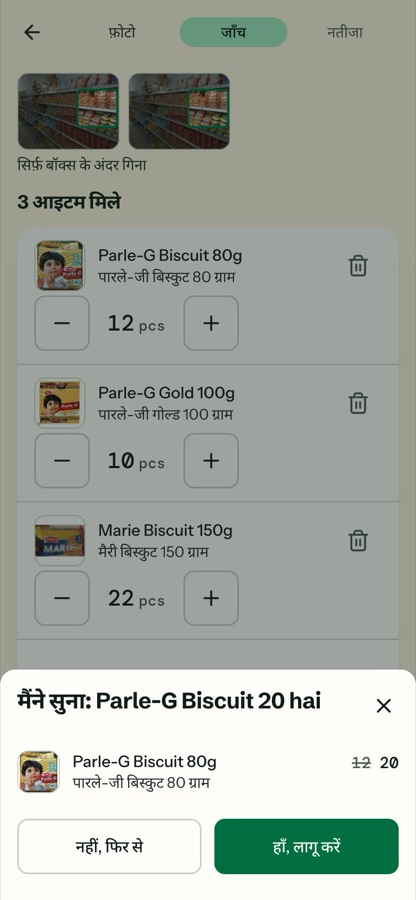
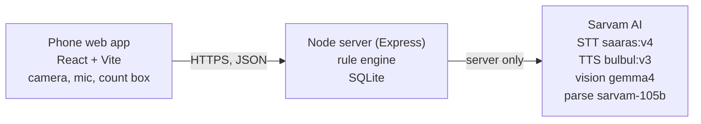

# KiranaQ

**Stock by photo and voice, for kirana stores with no POS and no bills.**

A kirana owner does not know what is left on the shelf. Billing apps need sale entries that he never makes.
KiranaQ needs one shelf photo and a short voice check in Hindi or Hinglish.
From two or more stock logs it learns how fast each item sells. Then it tells the owner, per distributor, what to order at the next visit and what runs out before that visit ("call early").



Built in one day for a buildathon (22 Nov 2026). This is a proof of concept.

- **Landing page:** https://kirana-q.replit.app/
- **Live app:** https://kirana-q.replit.app/app/

## How it works

| 1. Photo | 2. Count box | 3. Voice check | 4. Order per distributor |
|---|---|---|---|
|  |  |  |  |
| Tap "Stock ginen" and take or choose a shelf photo. | Drag the box over the part that faces the camera. The vision model counts only inside the box. | Say "Parle-G Biscuit 20 hai". The app shows what it heard and changes the count only after yes. | One card per distributor: what runs out before the next visit, and what to order. |

- **Sales rate:** rate = (stock before + delivered − stock now) ÷ days, from successive logs.
- **Restock detection:** a restock photo shows which items went up. The app asks which distributor delivered and records the visit.
- **Bolo:** a voice assistant in the tab bar. It answers questions and does app actions in Hindi or English.

## How it is different

| | Vyapar | Khatabook | KiranaQ |
|---|---|---|---|
| Input needed | Bills and sale entries | Ledger, bills and sale entries | Shelf photo and a short voice check |
| Visit cycle per distributor, "call early" alert | Not found | Not found | Yes |
| Voice in Hindi or Hinglish | None stated | None stated | Yes |
| Price for the store owner | Paid after a 7-day free trial | Free app with ads; paid plans | Free |

Sources and the full comparison: [`research/competitive.md`](research/competitive.md). "Not found" means we did not see the feature in public pages.

## Architecture



- One Node process serves the API, the landing page (`/`) and the app (`/app/`).
- The order rule is pure code with named settings in `server/src/core/config.js`. Every suggested number has a reason line.
- API keys stay on the server. All model calls live in `server/src/ai/`.
- **Planned, not built:** an Alpine Linux environment inside the app runs a small language model on the phone. It does UI actions offline and calls the server AI only for translation and heavy vision.

## Business model

The app stays free for the store owner. Each stock log shows what sells, in which neighbourhood store, how fast, and from which distributor. Aggregated, anonymised demand insights go to FMCG brands and distributor companies: launch tracking, stock-outs and reorder timing. The owner opts in. Data is shared only as aggregates across stores, and no personal data is collected.

## Run locally

Needs Node 22 and pnpm. Speech and vision need a Sarvam API key.

```bash
cp .env.example server/.env   # then add SARVAM_API_KEY
pnpm --dir server install && pnpm --dir web install
pnpm --dir web build          # builds into server/public
pnpm --dir server seed        # demo store: items, 3 distributors, past logs
pnpm --dir server start       # http://localhost:3000 (landing), /app/ (app)
```

For web development, run `pnpm --dir web dev` (port 5173, proxies `/api`), or `pnpm --dir web dev:mock` for a mock API.

## Test and evals

```bash
pnpm --dir server test         # unit and integration tests
pnpm --dir server demo:check   # end-to-end demo check
pnpm --dir server smoke:live   # one real call to each Sarvam model
pnpm --dir server eval:parse   # E2: voice phrases to count edits
pnpm --dir server eval:vision  # E1: photo counts against truth files
```

Latest results are in [`specs/2026-11-22-kiranaq-stock-log/checks.md`](specs/2026-11-22-kiranaq-stock-log/checks.md).

## Repository

| Folder | What it holds |
|---|---|
| `server/` | Node 22, Express, SQLite. API, rule engine (`src/core/`), model calls (`src/ai/`). Serves the built web app. |
| `web/` | React, Vite, Tailwind app. Builds into `server/public`. |
| `web/public/landing/` | Static landing page with a guided demo tour. |
| `evals/` | Voice, vision, assistant and restock evals. |
| `research/` | Competitive brief. |
| `specs/` | One folder per change: spec, tasks, checks, screenshots. |
| `shell/` | Android WebView shell (deferred, not in the demo). |

Design rules: [`DESIGN.md`](DESIGN.md). Deploy: Replit (see `.replit`). The same server serves the landing page and the app.

## License

[MIT](LICENSE)
