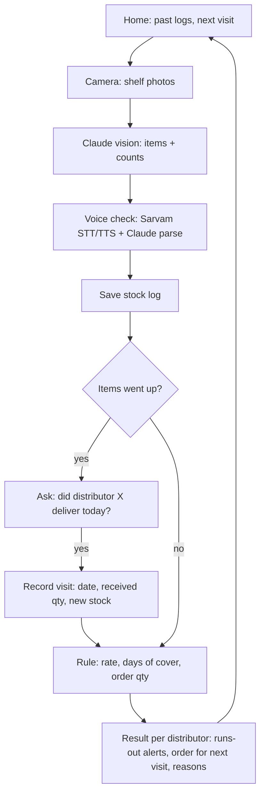
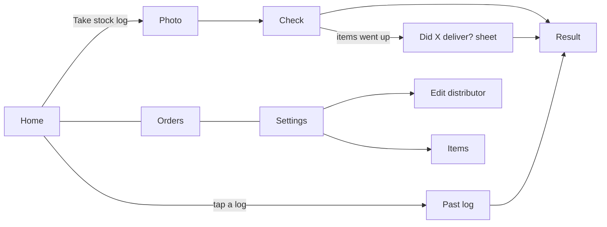

Status: draft (waiting for OK)

# KiranaQ: stock log by photo and voice, then a reorder list

Builds on the idea spec `~/repos/pm-brain/specs/2026-11-22-kirana-reorder-notebook/spec.md`. That spec asked the owner "what ran out, what was left?" This spec replaces the guess with a real count: the owner takes a photo of the shelf, a vision model counts, and the owner corrects the count by voice. The rest of the idea (transparent rule, reason line, voice in Hindi, named config) stays.

Build window: 22 Nov 2026, now until the 5:00 PM submit lock. Scope is cut to fit.

## 1. Why

A kirana owner has no POS and no bills. He buys from several distributors (for example one for HUL items, one for biscuits, one for staples). Each distributor's salesperson comes back on its own cycle (every 4 days, every 7 days, every 15 days). He orders by gut feel when each salesperson visits, so fast items run out and slow items pile up. KiranaQ lets him take a **stock log** in under a minute (photo plus a short voice check). From two or more logs the app knows how fast each item sells and how many days of stock are left. For each distributor it tells him two things: what to order at that distributor's next visit so stock lasts until the visit after, and which items will run out before that distributor comes back (so he can call that distributor early).

## 2. The story

1. **Home.** The owner opens the app. He sees his past stock logs: date, number of items, and items that are low. A strip shows each distributor and its next visit: "Sharma Traders (HUL): Tue 24 Nov, in 2 days", "Gupta Agency (biscuits): Sat 28 Nov, in 6 days".
2. **Take a stock log.** He taps "Take stock log". The camera opens. He takes one or more photos of the shelf.
3. **The vision model counts.** The server sends each photo to Claude vision with the store's item list. It returns items it can see and a count for each, with a confidence.
4. **Voice check.** The app reads the counts back in Hindi (text to speech): "Maggi 12, Parle-G 30, chini 4 kilo. Sahi hai?" The owner answers by voice: "Maggi 8 hai, aur Surf bhi 5 hai". Sarvam turns speech into text. Claude turns text into edits `{item, count}`. The app shows "I heard: Maggi 8, Surf 5. Correct?" and applies the edits on yes. Items not in the photo can be added by voice or by tap. Plus and minus buttons always work too.
5. **Save the log.** The log is saved with today's date.
6. **Compute.** For each item, the server compares this log with the last one: stock then, plus what arrived, minus stock now, gives what sold. Sold divided by days gives a daily rate. Stock now divided by rate gives **days of cover**. Each item belongs to one distributor, so the server also knows when that item can next be restocked.
7. **Result screen, one card per distributor**, sorted by next visit:
   - Header: "Sharma Traders: next visit Tue 24 Nov (in 2 days), then every 7 days".
   - **Runs out first** (red): items whose cover ends before this distributor's next visit. "Surf: 1 day left, Sharma comes in 2 days. Call Sharma early, or you are out for 1 day."
   - **Order at next visit**: for each item, the quantity to order so stock lasts until the visit after next, with a reason. "Maggi: 1.5/day, 5 days left. Order 2 cases on Tue so you still have stock on 1 Dec."
   - Items with enough stock until the visit after next show "No order needed".
8. **Order.** The owner confirms the order quantities per distributor (plus/minus) and places them with the salesperson as before.
9. **Restock log.** When the stock arrives, the owner takes a photo again, the same way. After the counts are confirmed, the app sees which items went up. It maps those items to their distributor and asks: "Maggi, Surf, Rin went up. Did Sharma Traders deliver today?" He says yes (tap or "haan"). The app then records the visit: Sharma came on this date, these quantities arrived, and this is the new stock. Sharma's next visit moves to this date + cycle. When items of two distributors went up, it asks for each one.



## 3. Requirements

- **R1. Stock log history.** Home shows all past logs, newest first, with date, item count and low-stock count. Tap a log to see its counts.
- **R2. Photo count.** The owner takes 1–3 photos. The server returns a list of `{item_id, count, confidence}` that uses only items in the store catalog. Unknown objects are dropped. When the vision call fails, the owner gets an empty list and can count by voice or tap (no crash).
- **R3. Voice check.** The app speaks the counts in Hindi or English. The owner speaks corrections. The app shows what it understood and applies it only after yes. When the item or number is unclear (low confidence or unknown item), the app asks again and does not guess.
- **R4. Manual edit.** Every count has plus and minus buttons and a remove button. Voice is never the only way.
- **R5. Rate and days of cover.** For each item with a previous log: `sold = prev_count + received − count_now`, `rate = sold ÷ days`, smoothed with the old rate. `days_of_cover = count_now ÷ rate`. When `count_now = 0`, the rate is raised by the stock-out step-up (true demand is hidden).
- **R6. Order suggestion per distributor.** Each item uses its own distributor's `days_to_next_visit` and `cycle_days`. The order placed at the next visit must last until the visit after: `order_qty = roundup_to_pack(rate × (days_to_next_visit + cycle_days) × SAFETY_MARGIN − count_now)`, never below 0. Example: rate 1.5/day, Sharma comes in 2 days, Sharma's cycle 7 days, safety 1.15, stock 5 → `1.5 × 9 × 1.15 − 5 = 10.5` → pack 6 → 12. When the same item had a 15-day distributor, the order is bigger.
- **R7. Runs-out alert per distributor.** When `days_of_cover < days_to_next_visit` of that item's distributor, the item shows "Runs out in N days, <distributor> comes in M days: call early, or out for M − N days". Home shows the count of such items per distributor.
- **R8. Reason line.** Every suggested quantity has a one-line reason in the owner's language.
- **R9. Distributors.** The store has a list of distributors. Each has a name, `cycle_days` and `last_visit_date`. Next visit = the first `last_visit_date + k × cycle_days` that is today or later. Each item has one distributor. The owner can add a distributor, change its cycle and last visit, and move an item to another distributor in a settings screen. When an item has no distributor, it uses `DEFAULT_CYCLE_DAYS` and shows "no distributor set".
- **R10. Named config.** All numbers in the rule (`SAFETY_MARGIN`, `STOCKOUT_STEP_UP`, `RATE_SMOOTHING`, `DEFAULT_CYCLE_DAYS`, `MIN_CONFIDENCE`, `RESTOCK_MIN_PACKS`) live in `server/src/core/config.js`. No number is hard-coded in the rule.
- **R11. Demo seed.** One command loads a synthetic store with ~25 items, 3 distributors with different cycles (for example 4, 7 and 15 days), and 3 past logs, so rates and alerts show at once for more than one distributor.
- **R13. Restock detection.** After a log is confirmed, for each distributor the app finds items with `count_now > expected_before + RESTOCK_MIN_PACKS × pack_size`. When at least one is found, the app asks "Did <distributor> deliver today?" and names up to 3 of the items. On yes: it saves a visit (distributor, date, log), sets the distributor's `last_visit_date` to the log date, and saves `received` per item. On no: nothing changes (the rise is treated as a count error the owner can fix). Example: Maggi was 2 cases, rate 0.5/day, 2 days ago, now 14 → expected 1, rise 13 → "Did Sharma deliver today?"
- **R12. Web app on a phone.** The POC is a web app only. It works in a phone browser (Chrome on Android, Safari on iOS) over HTTPS, so camera and microphone work. It can be deployed to one public HTTPS URL. The Android shell is deferred.

Out of scope: bills, prices, cash budget, distributor integration, login, multi-store, real owner data. Stretch only: the 12-cycle simulation chart from the idea spec, Kannada.

## 4. Design

### Architecture (copied from KidQueue, kept light)

- `server/`: Node 22, Express, better-sqlite3. One process. Serves the API and the built web UI. All model calls live in `server/src/ai/` (the only place with network I/O to models). The rule lives in `server/src/core/` (pure functions, no I/O).
- `web/`: React + Vite + Tailwind, mobile first, built into `server/public`.
- `shell/`: a minimal Kotlin WebView app is in the repo from the skeleton, but it is **deferred** (not built, not in the demo). The web app is the POC. The shell stays as the later path to an Android app (KidQueue idea: thin native host, web UI from the server).

**Secure context.** Browser microphone access (`getUserMedia`) needs HTTPS or `localhost`. Camera photo upload (`<input type=file capture>`) does not. So the phone must open an HTTPS URL.

**During the build.** Test in the laptop browser on `localhost` (a secure context, so the mic works) in phone-size view. Photo upload is tested with a saved shelf photo.

**Deploy at the end: Replit.** One Node process serves API and UI, so it runs as one Replit app with HTTPS by default. Build step: `pnpm --dir web build`, run step: `pnpm --dir server start`, port from `PORT`. Keys go in Replit Secrets, never in git. The Replit deploy file system may not keep the SQLite file across restarts, so the server runs the seed when the database is empty. Then the phone opens the Replit URL for the real photo and mic test. Fallback if the deploy fails: demo from the laptop browser, with a text box for the voice transcript.

### Models

| Job | Model | Where |
|---|---|---|
| Count items in a photo | Claude vision (`claude-sonnet-5-5`), JSON output | `ai/vision.js` |
| Speech to text (hi-IN, en-IN) | Sarvam speech to text | `ai/sarvam.js` |
| Text to speech | Sarvam text to speech | `ai/sarvam.js` |
| Spoken text → edits JSON | Claude (`claude-haiku-5-5`), JSON output | `ai/parse.js` |

Exact Sarvam model names and endpoints come from the credits docs (open question 1). Keys come from env vars only.

Vision prompt gets the store catalog (id, names in en/hi, pack) and must answer only with `[{item_id, count, confidence}]`. The server validates: known `item_id`, integer count 0–999, confidence 0–1. Counts from a crowded shelf are rough; the voice check is there to fix them.

### Data model (SQLite)

One SQLite file (`DB_PATH`, default `server/data/kiranaq.db`). Schema lives in `server/src/migrations.js` as migration 1. Business dates are `TEXT` `YYYY-MM-DD` in store local time (IST). Timestamps are `TEXT` ISO 8601 UTC. Every table that holds store data has `store_id`, and every query filters by it (tenant rule, even with one store).

**What is stored:** the store, its distributors, its item list, each stock log and its counts, the suggested and final order lines, visits and what arrived, the learned rate per item, and a log of model calls (no content).
**What is never stored:** photos, audio, transcripts of speech, API keys, any real person's name or phone number. Photos and audio stay in memory for the length of one request.

```sql
CREATE TABLE store (
  id            INTEGER PRIMARY KEY,
  name          TEXT NOT NULL,               -- synthetic, e.g. "Demo Kirana"
  language      TEXT NOT NULL DEFAULT 'hi' CHECK (language IN ('hi','en')),
  created_at    TEXT NOT NULL
);

CREATE TABLE distributor (
  id              INTEGER PRIMARY KEY,
  store_id        INTEGER NOT NULL REFERENCES store(id),
  name            TEXT NOT NULL,             -- "Sharma Traders"
  note            TEXT,                      -- "HUL items"
  cycle_days      INTEGER NOT NULL CHECK (cycle_days BETWEEN 1 AND 60),
  last_visit_date TEXT,                      -- YYYY-MM-DD, null = unknown
  created_at      TEXT NOT NULL,
  UNIQUE (store_id, name)
);

CREATE TABLE item (
  id             INTEGER PRIMARY KEY,
  store_id       INTEGER NOT NULL REFERENCES store(id),
  distributor_id INTEGER REFERENCES distributor(id),   -- null = "no distributor set"
  sku_key        TEXT NOT NULL,              -- stable key from data/catalog.json, e.g. "maggi_70g"
  name_en        TEXT NOT NULL,
  name_hi        TEXT NOT NULL,
  aliases        TEXT NOT NULL DEFAULT '[]', -- JSON array of spoken names: ["maggi","noodles","मैगी"]
  item_group     TEXT NOT NULL,              -- staples | snacks | biscuits | drinks | personal_care | home_care
  unit           TEXT NOT NULL,              -- pcs | kg | packet | bottle
  pack_size      INTEGER NOT NULL CHECK (pack_size >= 1),  -- units per distributor pack/case
  active         INTEGER NOT NULL DEFAULT 1,
  UNIQUE (store_id, sku_key)
);

CREATE TABLE stock_log (
  id           INTEGER PRIMARY KEY,
  store_id     INTEGER NOT NULL REFERENCES store(id),
  log_date     TEXT NOT NULL,               -- YYYY-MM-DD (business date)
  created_at   TEXT NOT NULL,
  source       TEXT NOT NULL CHECK (source IN ('photo','manual')),
  photo_count  INTEGER NOT NULL DEFAULT 0,  -- how many photos were sent (photos are not kept)
  has_restock  INTEGER NOT NULL DEFAULT 0
);
CREATE INDEX idx_stock_log_store_date ON stock_log(store_id, log_date DESC);

CREATE TABLE stock_count (
  log_id            INTEGER NOT NULL REFERENCES stock_log(id) ON DELETE CASCADE,
  item_id           INTEGER NOT NULL REFERENCES item(id),
  store_id          INTEGER NOT NULL REFERENCES store(id),
  count             INTEGER NOT NULL CHECK (count BETWEEN 0 AND 9999),  -- in units, not packs
  source            TEXT NOT NULL CHECK (source IN ('vision','voice','tap')),  -- who set the final value
  vision_count      INTEGER,                -- what the model said, for later accuracy checks
  vision_confidence REAL,
  PRIMARY KEY (log_id, item_id)
);

CREATE TABLE item_result (                  -- rule output per item per log (what the Result screen shows)
  log_id           INTEGER NOT NULL REFERENCES stock_log(id) ON DELETE CASCADE,
  item_id          INTEGER NOT NULL REFERENCES item(id),
  store_id         INTEGER NOT NULL REFERENCES store(id),
  distributor_id   INTEGER REFERENCES distributor(id),
  rate_per_day     REAL,                    -- null on first log
  days_of_cover    REAL,                    -- null when rate is 0 or unknown
  next_visit_date  TEXT,
  status           TEXT NOT NULL CHECK (status IN ('runs_out','order','ok','no_history')),
  suggested_qty    INTEGER NOT NULL DEFAULT 0,   -- in units, a multiple of pack_size
  final_qty        INTEGER,                 -- what the owner confirmed; null = not confirmed
  reason_key       TEXT NOT NULL,           -- template id, e.g. "runs_out_before_visit"
  reason_args      TEXT NOT NULL,           -- JSON args for the template; text is built in the UI language
  PRIMARY KEY (log_id, item_id)
);

CREATE TABLE visit (
  id             INTEGER PRIMARY KEY,
  store_id       INTEGER NOT NULL REFERENCES store(id),
  distributor_id INTEGER NOT NULL REFERENCES distributor(id),
  log_id         INTEGER NOT NULL REFERENCES stock_log(id) ON DELETE CASCADE,
  visited_on     TEXT NOT NULL,             -- = the log date
  created_at     TEXT NOT NULL,
  UNIQUE (distributor_id, log_id)           -- confirming twice is safe (idempotent)
);

CREATE TABLE receipt (
  visit_id     INTEGER NOT NULL REFERENCES visit(id) ON DELETE CASCADE,
  item_id      INTEGER NOT NULL REFERENCES item(id),
  store_id     INTEGER NOT NULL REFERENCES store(id),
  received_qty INTEGER NOT NULL CHECK (received_qty >= 0),
  PRIMARY KEY (visit_id, item_id)
);

CREATE TABLE item_state (                   -- the learned rate, updated after each log
  store_id     INTEGER NOT NULL REFERENCES store(id),
  item_id      INTEGER NOT NULL REFERENCES item(id),
  rate_per_day REAL,
  last_log_id  INTEGER REFERENCES stock_log(id),
  updated_at   TEXT NOT NULL,
  PRIMARY KEY (store_id, item_id)
);

CREATE TABLE ai_call (                      -- one row per model call, no content
  id          INTEGER PRIMARY KEY,
  store_id    INTEGER NOT NULL REFERENCES store(id),
  kind        TEXT NOT NULL CHECK (kind IN ('vision','stt','tts','parse')),
  provider    TEXT NOT NULL,                -- anthropic | sarvam
  model       TEXT NOT NULL,
  ok          INTEGER NOT NULL,
  latency_ms  INTEGER NOT NULL,
  error_code  TEXT,                         -- short code only, no response body
  created_at  TEXT NOT NULL
);
```

Notes:
- Counts and order quantities are stored in **units**. The UI shows them as packs plus loose units ("2 cases + 4") using `pack_size`.
- Reason lines are stored as a template key plus JSON args, not as text. The UI builds the sentence in the chosen language, so a language switch changes old results too.
- The draft of a log (photo counts before the owner says yes) lives only in the browser. Nothing is written until `POST /api/logs`.
- `data/catalog.json` is the starter list (about 25 items for the demo). `scripts/seed.js` copies it into `item` for the demo store, adds 3 distributors, 3 past logs, their results and one visit.
- Saving a log is one transaction: `stock_log`, `stock_count`, `item_result`, `item_state`. Confirming a visit is one transaction: `visit`, `receipts`, `distributor.last_visit_date`, and recomputed `item_result` rows for that log.

### API

- `GET /api/store`, `PUT /api/store` (language)
- `GET /api/distributors`, `POST /api/distributors`, `PUT /api/distributors/:id` (name, cycle_days, last_visit_date)
- `GET /api/items`, `PUT /api/items/:id` (distributor_id, active)
- `GET /api/logs`, `GET /api/logs/:id`
- `POST /api/vision/count` (multipart images) → draft counts
- `POST /api/voice/stt` (multipart audio) → text; `POST /api/voice/tts` (text, lang) → audio
- `POST /api/voice/parse` (text, current draft) → `{edits:[{item_id, count}], unclear:bool, ask?:string}`
- `POST /api/logs` (final counts) → saves log, runs rule, returns result grouped by distributor
- `PUT /api/logs/:id/order` (final order qty)
- `POST /api/logs/:id/visits` (`{distributor_id, confirmed}`) → on yes saves visit and receipts, moves next visit, returns the updated cards

### The rule (`core/rule.js`, pure)

**Restock (`core/restock.js`, pure).** For each item: `expected_before = max(p − o × d, 0)` (or `p` with no rate). `rise = c − expected_before`. Items with `rise > RESTOCK_MIN_PACKS × pack_size` are grouped by distributor into "delivery candidates". On a confirmed visit, `received = rise` per item of that distributor.

**Rate.** For each active item, given previous count `p`, received `r` (from a confirmed visit between the two logs, else 0), current count `c`, days `d` since last log, old rate `o`, and its distributor's `cycle_days` and `days_to_next_visit` (from `core/schedule.js`, pure: `next_visit(last_visit_date, cycle_days, today)`):

1. `sold = max(p + r − c, 0)`
2. `observed = sold ÷ d`; if `c = 0` then `observed × (1 + STOCKOUT_STEP_UP)`
3. `rate = o is null ? observed : RATE_SMOOTHING × observed + (1 − RATE_SMOOTHING) × o`
4. `days_of_cover = rate > 0 ? c ÷ rate : Infinity`
5. `need = rate × (days_to_next_visit + cycle_days) × SAFETY_MARGIN − c`
6. `order_qty = roundup_to_pack(max(need, 0))`
7. `call_early = days_of_cover < days_to_next_visit`; `days_out = days_to_next_visit − days_of_cover` when true
8. `reason`: built from a template per case (runs out before visit / order needed / no order needed / ran out last time / no history), with the distributor name and visit date.

`core/plan.js` (pure) then groups item results by distributor, sorts distributors by next visit, and sorts items inside a card: runs-out first, then order lines, then "no order needed".

First log of an item (no history): no rate, no order suggestion, reason "first log, need one more".

On a log with a confirmed delivery, `received` is estimated from the old rate, so the rate for those items does not change on that log (it would only repeat the old rate). The rate learns from logs without a delivery in between. Best practice we tell the owner: take a log when the salesperson comes (that log makes the order), and one after the stock arrives (that log records the visit). Then `received` is exact: count after minus count before.

### UI tech

| Part | Choice | Why |
|---|---|---|
| Framework | React 18 + Vite 5 (already in `web/`) | Copied from KidQueue; fast build. |
| Styling | Tailwind CSS 3, colors from CSS variables | Theme in one place (see Theming). |
| Routing | `react-router-dom` v6, browser routes, server SPA fallback | Back button works on the phone. |
| Icons | `lucide-react` | Small, tree-shaken, consistent stroke. |
| Components | Our own, in `web/src/ui/`: `Button`, `IconButton`, `Card`, `Stepper` (− qty +), `Sheet` (bottom sheet), `Dialog`, `Toast`, `Badge`, `TopBar`, `TabBar` | No component library: less weight, full control. About 20–60 lines each. |
| State | React state + one `useStore` context for store, distributors and items; draft log in `sessionStorage` so a refresh does not lose counts | No Redux or Zustand needed. |
| Data | `web/src/api.js` (fetch, JSON, error to toast) | Exists. |
| Audio | `MediaRecorder` (webm/opus or mp4 on Safari) → upload; `<audio>` plays TTS | Browser built-in. |
| Camera | `<input type="file" accept="image/*" capture="environment" multiple>`; images resized to max 1600 px on a canvas before upload | Works on every phone browser, no camera library. Smaller upload, cheaper vision call. |
| Text | `web/src/i18n.js`: one dictionary `{en:{…}, hi:{…}}` and a `t(key, args)` helper; reason templates live here too | Hindi and English from day one. |
| Fonts | Noto Sans + Noto Sans Devanagari (Google Fonts), `font-variant-numeric: tabular-nums` for counts | Same look for Hindi and English; numbers line up. |

### Theming

Colors are tokens in `web/src/index.css` on `:root`, with a dark set under `prefers-color-scheme: dark` and under `[data-theme="dark"]`. Tailwind maps names to the tokens (`bg-surface`, `text-ink`, `bg-primary`, …), so no component uses a raw hex value.

| Token | Light | Use |
|---|---|---|
| `--bg` | warm off-white | page |
| `--surface` | white | cards, sheets |
| `--ink` / `--ink-muted` | near-black / grey | text |
| `--primary` | deep green | main actions, "enough stock" |
| `--accent` | turmeric amber | "order needed" |
| `--danger` | brick red | "runs out before visit" |
| `--line` | light grey | borders |

Status is never shown by color alone: each status has an icon and a word (red + `AlertTriangle` + "Runs out", amber + `ShoppingCart` + "Order", green + `CheckCircle2` + "Enough", grey + `Clock` + "First log").

Size rules: base font 17 px, numbers 20–28 px, tap targets at least 48 px, primary actions in the bottom third of the screen (one-hand use), max content width 480 px (centered on a laptop). Theme choice (system, light, dark) is in Settings and kept in `localStorage`.

### Navigation and menu

- **Bottom tab bar** with 3 tabs: **Home** (`House`), **Orders** (`ClipboardList`), **Settings** (`Settings`). No hamburger menu.
- **Big round "Take stock log" button** (`Camera`) floats above the tab bar, center, on Home and Orders.
- The log flow is full screen, no tab bar: a top bar with back arrow and a 3-step indicator **Photo → Check → Result**. Back from Check asks "Discard this log?"
- Language chip **हिं / EN** in the top bar of Home. It switches all text at once.

Routes:

| Route | Screen |
|---|---|
| `/` | Home |
| `/orders` | Orders (latest result, one card per distributor) |
| `/log/new` | Step 1 Photo |
| `/log/new/check` | Step 2 Check counts (voice + tap) |
| `/log/:id/result` | Step 3 Result (also opened from Home) |
| `/log/:id` | Past log (read-only counts) |
| `/settings` | Settings home |
| `/settings/distributors/:id` | Edit distributor (name, cycle, last visit, its items) |
| `/settings/items` | Items: active on/off, distributor per item |



### Screens (layout)

**Home**
```
┌──────────────────────────────┐
│ Demo Kirana        [हिं|EN]  │
│ Next visits                  │
│ ┌──────┐┌──────┐┌──────┐     │  ← horizontal chips, scroll
│ │Sharma││Gupta ││Mehta │     │
│ │in 2d ││in 6d ││in 11d│     │
│ │⚠ 2   ││      ││⚠ 1   │     │  ← items that run out first
│ └──────┘└──────┘└──────┘     │
│ Stock logs                   │
│ Today 22 Nov · 24 items · ⚠3 │
│ Fri 20 Nov · 23 items  ·🚚 S │  ← 🚚 = visit recorded
│ Tue 17 Nov · 22 items        │
│            ( 📷 )            │  ← Take stock log
│ [Home]   [Orders]  [Settings]│
└──────────────────────────────┘
```
Empty state (no logs): one card "Take your first stock log. Two logs are needed to learn how fast items sell."

**Step 1 Photo**: big dashed area "Take a photo of your shelf" (opens camera), thumbnails of up to 3 photos with remove ×, a secondary link "Count without photo", primary button "Count items" (disabled until one photo). While waiting: skeleton list and "Counting items…" (vision call, target under 15 s).

**Step 2 Check**
```
┌──────────────────────────────┐
│ ←  Photo · CHECK · Result    │
│ 🔊 Read out   18 items found │
│ Maggi 70g       ⓘ 92%        │
│ [−]  12 pcs  (1 case+0) [+]  │
│ Parle-G         ⓘ 61% low    │  ← low confidence: amber outline
│ [−]  30 pcs             [+]  │
│ + Add item                   │
│ ┌──────────────────────────┐ │
│ │ 🎤 Hold to speak         │ │  ← sticky bottom
│ └──────────────────────────┘ │
│ [ Save log ]                 │
└──────────────────────────────┘
```
After speech, a bottom sheet: "I heard: Maggi 8, Surf 5" with the changed rows, buttons **Yes, apply** and **No, try again**. An unclear phrase shows the question from the parser ("Which Surf: 500 g or 1 kg?"). A text box under the mic is the fallback.

**Visit sheet** (after Save, only when items went up): "Did Sharma Traders deliver today? Maggi +12, Surf +6, Rin +4" with **Yes, delivered** / **No**. One sheet per distributor.

**Step 3 Result / Orders**
```
┌──────────────────────────────┐
│ Sharma Traders · Tue 24 Nov  │
│ in 2 days · every 7 days     │
│ ⚠ RUNS OUT FIRST             │
│ Surf 1kg   1 day left        │
│  "Runs out tomorrow, Sharma  │
│   comes in 2 days. Call      │
│   early."        [📞 note]   │
│ 🛒 ORDER ON TUE              │
│ Maggi     [−] 2 cases [+]    │
│  "1.5/day, 5 days left…"     │
│ ✓ Enough: Rin, Vim (tap)     │
│ [ Confirm Sharma order ]     │
└──────────────────────────────┘
  (next card: Gupta Agency …)
```
"Read out" button speaks the order list for one distributor (TTS), so the owner can read it to the salesperson. "Copy list" copies it as plain text (to paste in WhatsApp; the app does not send it).

**Settings**: list rows: Distributors (count), Items (count), Language, Theme (System / Light / Dark), Demo data (Reset to demo, asks first), About (version, "Synthetic data only").

### Loading, errors, empty states

- Every network call shows a busy state on the button that started it, and the button is disabled while busy (no double submit).
- Model call fails → toast "Could not count from photo. Count by voice or tap." and the Check screen opens with an empty list.
- Mic not allowed → the mic button shows "Mic blocked: type instead" and the text box opens.
- No distributor set for an item → it goes in a last card "No distributor" with a link to Settings.

## 5. Verification

| Req | Check |
|---|---|
| R1 | Manual: seed, open Home, 3 logs shown newest first |
| R2 | Live: photo of a real shelf returns known items only; unit test: validator drops unknown ids and bad counts; kill key → empty list, no crash |
| R3 | 5 Hindi + 3 English spoken phrases parse right or re-ask; unclear phrase re-asks |
| R4 | Manual walk through on phone-size view |
| R5, R6, R7 | `node --test`: worked example in R6, stock-out case, first-log case, call-early case, same item under a 4-day vs 15-day distributor gives a smaller vs bigger order |
| R8 | Manual: every row has a reason |
| R9 | `node --test` for `next_visit` (visit today, visit missed, long cycle); manual: change a distributor's cycle, its card changes and other cards do not; move an item, it moves card |
| R10 | `rg -n "[0-9]" server/src/core/rule.js` shows only 0 and 1 |
| R11 | `pnpm seed` then Home shows rates and at least one alert |
| R13 | `node --test` for `restock.js`: worked example in R13, a small rise below the threshold is ignored, rises of two distributors give two questions; manual: confirm a visit, distributor's next visit moves, Home strip updates |
| R12 | Phone browser on the HTTPS URL: photo and mic both work; screenshot |

## 6. Open questions (proposed answers)

1. **Sarvam model names.** Proposal: Alaf reads them from the credits docs now; until then assume `saarika` (STT) and `bulbul` (TTS) on `api.sarvam.ai`.
2. **Distributor cycles.** Each distributor has its own cycle (decided). Proposal: the owner sets the cycle and last visit per distributor in Settings; `DEFAULT_CYCLE_DAYS = 7` only for items with no distributor. A visit is recorded from the restock photo (R13); the owner can also set the last visit by tap in Settings.
3. **Received quantity (decided: from the restock photo).** Proposal for the threshold: `RESTOCK_MIN_PACKS = 1` (a rise of at least one pack). Should actual visit dates also correct the cycle (for example Sharma came after 9 days, not 7)? Proposal: keep the visits; show "last 3 visits: every 8 days" in Settings as a stretch; do not change the cycle on its own.
4. **Deploy target (decided: web first, Replit at the end).** Proposal: deploy to Replit after the live flow works on localhost (about 4:15 PM). Android shell later.
5. **Simulation chart.** Proposal: stretch only, after the live flow works.

Assumptions: starter catalog and seed are synthetic; photo counts are rough and the voice check is the fix; one store only.

## 7. Security review (manual)

The `spec-security-review` skill is not installed, so this is a short manual check.

- **Secrets:** `ANTHROPIC_API_KEY`, `SARVAM_API_KEY` in `.env` only; `.env` in `.gitignore`; never logged.
- **Personal data:** none stored. Synthetic store. No login.
- **Photos and audio:** sent to Anthropic and Sarvam for processing, not stored on disk after the request (multer memory storage). Use our own test shelf photos and voices only.
- **Model output:** treated as data. JSON is schema-validated (known ids, number ranges) before use; never executed.
- **Network:** the Replit URL is public. No auth, so use synthetic data only, and stop the deployment after the demo. A deployed service can spend model credits if someone finds the URL: add a simple shared demo key header or rate limit before it stays up longer than the demo.
- **Tenant isolation:** one store; every query still filters by `store_id` so a second store cannot leak.
- **Findings:** 0 blocking. 1 open: the public URL has no auth and calls paid models (accepted for the demo; stop it after, or add a demo key and rate limit before a longer deploy).
