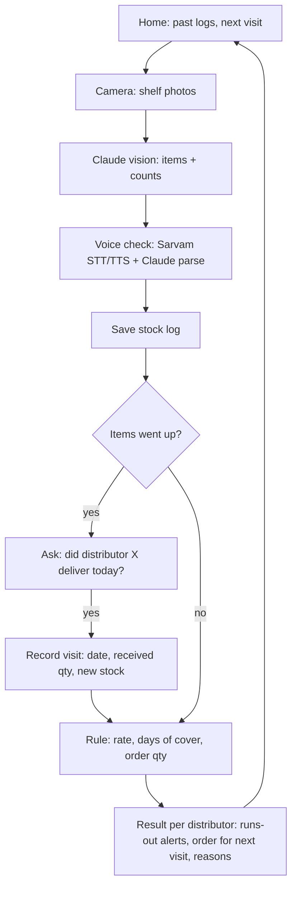
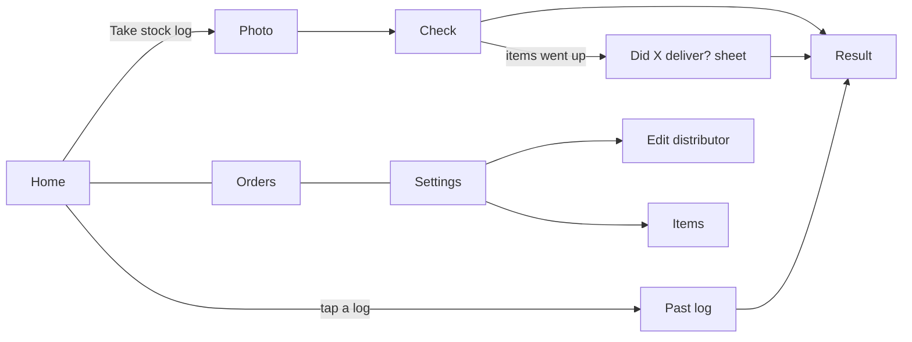

Status: draft (waiting for OK)

# KiranaQ: stock log by photo and voice, then a reorder list

Builds on the idea spec `~/repos/pm-brain/specs/2026-11-22-kirana-reorder-notebook/spec.md`. That spec asked the owner "what ran out, what was left?" This spec replaces the guess with a real count: the owner takes a photo of the shelf, a vision model counts, and the owner corrects the count by voice. The rest of the idea (transparent rule, reason line, voice in Hindi, named config) stays.

Build window: 22 Nov 2026, now until the 5:00 PM submit lock. Scope is cut to fit.

## 1. Why

A kirana owner has no POS and no bills. He buys from several distributors (for example one for HUL items, one for biscuits, one for staples). Each distributor's salesperson comes back on its own cycle (every 4 days, every 7 days, every 15 days). He orders by gut feel when each salesperson visits, so fast items run out and slow items pile up. KiranaQ lets him take a **stock log** in under a minute (photo plus a short voice check). From two or more logs the app knows how fast each item sells and how many days of stock are left. For each distributor it tells him two things: what to order at that distributor's next visit so stock lasts until the visit after, and which items will run out before that distributor comes back (so he can call that distributor early).

## 2. The story

1. **Home.** The owner opens the app. He sees his past stock logs: date, number of items, and items that are low. A strip shows each distributor and its next visit: "Sharma Traders (HUL): Tue 24 Nov, in 2 days", "Gupta Agency (biscuits): Sat 28 Nov, in 6 days".
2. **Take a stock log.** He taps "Take stock log". The camera opens. He takes one or more photos of the shelf.
3. **The vision model counts.** The server sends each photo to Claude vision with the store's item list. It returns items it can see and a count for each, with a confidence.
4. **Voice check.** The app reads the counts back in Hindi (text to speech): "Maggi 12, Parle-G 30, chini 4 kilo. Sahi hai?" The owner answers by voice: "Maggi 8 hai, aur Surf bhi 5 hai". Sarvam turns speech into text. Claude turns text into edits `{item, count}`. The app shows "I heard: Maggi 8, Surf 5. Correct?" and applies the edits on yes. Items not in the photo can be added by voice or by tap. Plus and minus buttons always work too.
5. **Save the log.** The log is saved with today's date.
6. **Compute.** For each item, the server compares this log with the last log that counted it: stock then minus stock now gives what sold (a log where stock went up by a delivery keeps the old rate). Sold divided by days gives a daily rate. Stock now divided by rate gives **days of cover**. Each item belongs to one distributor, so the server also knows when that item can next be restocked.
7. **Result screen, one card per distributor**, sorted by next visit:
   - Header: "Sharma Traders: next visit Tue 24 Nov (in 2 days), then every 7 days".
   - **Runs out first** (red): items whose cover ends before this distributor's next visit. "Surf: 1 day left, Sharma comes in 2 days. Call Sharma early, or you are out for 1 day."
   - **Order at next visit**: for each item, the quantity to order so stock lasts until the visit after next, with a reason. "Maggi: 1.5/day, 5 days left. Order 2 cases on Tue so you still have stock on 1 Dec."
   - Items with enough stock until the visit after next show "No order needed".
8. **Order.** The owner confirms the order quantities per distributor (plus/minus) and places them with the salesperson as before.
9. **Restock log.** When the stock arrives, the owner takes a photo again, the same way. After the counts are confirmed, the app sees which items went up. It maps those items to their distributor and asks: "Maggi, Surf, Rin went up. Did Sharma Traders deliver today?" He says yes (tap or "haan"). The app then records the visit: Sharma came on this date, these quantities arrived, and this is the new stock. Sharma's next visit moves to this date + cycle. When items of two distributors went up, it asks for each one.



## 3. Requirements

- **R1. Stock log history.** Home shows all past logs, newest first, with date, item count and low-stock count. Tap a log to see its counts.
- **R2. Photo count.** The owner takes 1–3 photos. The server returns a list of `{item_id, count, confidence}` that uses only items in the store catalog. Unknown objects are dropped. When the vision call fails, the owner gets an empty list and can count by voice or tap (no crash).
- **R3. Voice check.** The app speaks the counts in Hindi or English. The owner speaks corrections. The app shows what it understood and applies it only after yes. When the item or number is unclear (low confidence or unknown item), the app asks again and does not guess.
- **R4. Manual edit.** Every count has plus and minus buttons and a remove button. Voice is never the only way.
- **R5. Rate and days of cover.** For each item counted in this log and in an earlier log: `sold = prev_count − count_now`, `rate = sold ÷ days`, smoothed with the old rate. `days_of_cover = count_now ÷ rate`. When `count_now = 0`, the rate is raised by the stock-out step-up (true demand is hidden). The rate does not change when the logs are on the same day or when the count went up by a pack or more (a delivery); then the old rate is used. An item left out of a log is "not counted" (not 0): it gets no result in that log and its rate does not change.
- **R6. Order suggestion per distributor.** Each item uses its own distributor's `days_to_next_visit` and `cycle_days`. The order placed at the next visit must last until the visit after: `order_qty = roundup_to_pack(rate × (days_to_next_visit + cycle_days) × SAFETY_MARGIN − count_now)`, never below 0. Example: rate 1.5/day, Sharma comes in 2 days, Sharma's cycle 7 days, safety 1.15, stock 5 → `1.5 × 9 × 1.15 − 5 = 10.5` → pack 6 → 12. When the same item had a 15-day distributor, the order is bigger.
- **R7. Runs-out alert per distributor.** When `days_of_cover < days_to_next_visit` of that item's distributor, the item shows "Runs out in N days, <distributor> comes in M days: call early, or out for M − N days". A runs-out item also has an order quantity (R6) and a stepper; the distributor's order includes it. Home shows the count of such items per distributor.
- **R8. Reason line.** Every suggested quantity has a one-line reason in the owner's language.
- **R9. Distributors.** The store has a list of distributors. Each has a name, `cycle_days` and `last_visit_date`. Next visit = the first `last_visit_date + k × cycle_days` with `k ≥ 1` that is today or later (so a visit recorded today moves the next visit to today + cycle). When `last_visit_date` is not set, next visit = today + `cycle_days` and the card says "visit date not set". Each item has one distributor. The owner can add a distributor, change its cycle and last visit, and move an item to another distributor in a settings screen. When an item has no distributor, it uses `DEFAULT_CYCLE_DAYS` and shows "no distributor set".
- **R10. Named config.** All numbers in the rule (`SAFETY_MARGIN`, `STOCKOUT_STEP_UP`, `RATE_SMOOTHING`, `DEFAULT_CYCLE_DAYS`, `MIN_CONFIDENCE`, `RESTOCK_MIN_PACKS`), the request limits and the model names live in `server/src/core/config.js` (pure constants, no `process.env`). `server/src/config.js` keeps only server settings (paths, port, host). No number is hard-coded in the rule.
- **R11. Demo seed.** One command (`pnpm --dir server seed`, `--reset` clears the store first) loads a synthetic store with ~25 items, 3 distributors with different cycles (for example 4, 7 and 15 days), and 3 past logs, so rates and alerts show at once for more than one distributor. All seed dates are relative to `clock.today()` (for example today − 6, − 3, − 1), so the demo works on any day.
- **R12. Web app on a phone.** The POC is a web app only. It works in a phone browser (Chrome on Android, Safari on iOS) over HTTPS, so camera and microphone work. It can be deployed to one public HTTPS URL. The Android shell is deferred.
- **R13. Restock detection.** After a log is saved, for each distributor the app finds items with `rise ≥ RESTOCK_MIN_PACKS × pack_size`, where `rise = count_now − expected_before` (all in units). When at least one is found, the app asks "Did <distributor> deliver today?" and names up to 3 of the items. On yes: it saves a visit (distributor, date, log), sets the distributor's `last_visit_date` to the log date, and saves `received = rise` per item. On no: only the visit is not saved (the rise is treated as a count error the owner can fix). In both cases the rate of a risen item stays at the old rate (R5). Example (Maggi, pack 6 units): 4 units 2 days ago, rate 0.5/day → expected 3; now 16 → rise 13 ≥ 6 → "Did Sharma deliver today?", received 13.

Out of scope: bills, prices, cash budget, distributor integration, login, multi-store, real owner data. Stretch only: the 12-cycle simulation chart from the idea spec, Kannada.

## 4. Design

### Architecture (copied from KidQueue, kept light)

- `server/`: Node 22, Express, better-sqlite3. One process. Serves the API and the built web UI. All model calls live in `server/src/ai/` (the only place with network I/O to models). The rule lives in `server/src/core/` (pure functions, no I/O).
- `web/`: React + Vite + Tailwind, mobile first, built into `server/public`.
- `shell/`: a minimal Kotlin WebView app is in the repo from the skeleton, but it is **deferred** (not built, not in the demo). The web app is the POC. The shell stays as the later path to an Android app (KidQueue idea: thin native host, web UI from the server).

**Secure context.** Browser microphone access (`getUserMedia`) needs HTTPS or `localhost`. Camera photo upload (`<input type=file capture>`) does not. So the phone must open an HTTPS URL.

**During the build.** Test in the laptop browser on `localhost` (a secure context, so the mic works) in phone-size view. Photo upload is tested with a saved shelf photo.

**Deploy at the end: Replit.** One Node process serves API and UI, so it runs as one Replit app with HTTPS by default. Build step: `pnpm --dir web build`, run step: `pnpm --dir server start`, port from `PORT`. Keys go in Replit Secrets, never in git. The Replit deploy file system may not keep the SQLite file across restarts, so the server runs the seed when the database is empty. Then the phone opens the Replit URL for the real photo and mic test. Fallback if the deploy fails: demo from the laptop browser, with a text box for the voice transcript.

### Models

| Job | Model | Where |
|---|---|---|
| Count items in a photo | Claude vision (`claude-sonnet-5-5`), JSON output. Option behind `VISION_PROVIDER=sarvam`: Sarvam chat `gemma4` with a base64 image (compare in E1 if time) | `ai/vision.js` |
| Speech to text (hi-IN, en-IN, Hinglish) | Sarvam `POST /speech-to-text`, model `saaras:v4`, `mode=codemix`, `language_code` left out (auto-detect), `keyterms` = up to 50 item names and aliases from the catalog | `ai/sarvam.js` |
| Text to speech | Sarvam `POST /text-to-speech`, model `bulbul:v3` (the round trip passed with it), default speaker; reply is base64 WAV in `audios[0]`. `bulbul:v4-flash` with speaker `shubh_enhi_ads` is an option (open question 1) | `ai/sarvam.js` |
| Spoken text → edits JSON | Claude (`claude-haiku-5-5`), JSON output | `ai/parse.js` |

Sarvam auth header: `api-subscription-key`. Node SDK `sarvamai` is installed. `server/src/ai/sarvam.js` exists and works (TTS → STT round trip passed): `speak(text, {languageCode, speaker})` returns a WAV `Buffer`; `transcribe(audio, {filename, mimeType, languageCode})` returns `{transcript, languageCode}`. Keep these names. `ai/real.js` adapts them to the `ai` interface: `stt(audio, opts)` → `{text: transcript}`, `tts(text, opts)` → `Buffer`. Lane C adds `keyterms` to `transcribe` and moves its model names and limits into `core/config.js`. Limits that shape the UI: STT takes at most 30 s of audio per request (the mic stops at `MAX_RECORD_SECONDS = 25`); TTS takes at most 2,500 characters (we cap at `MAX_TTS_CHARS = 500`). Keys come from env vars only. Model names live in `config.js`.

Vision prompt gets the store catalog (id, names in en/hi, pack) and must answer only with `[{item_id, count, confidence}]`. The server validates: known `item_id`, integer count 0–999, confidence 0–1. Items with unit `kg` are counted in whole units; loose goods (for example chini in a bin) are not counted by vision, the owner adds them by voice or tap. Counts from a crowded shelf are rough; the voice check is there to fix them.

### Data model (SQLite)

One SQLite file (`DB_PATH`, default `server/data/kiranaq.db`). Schema lives in `server/src/migrations.js` as migration 1. Business dates are `TEXT` `YYYY-MM-DD` in store local time (IST). Timestamps are `TEXT` ISO 8601 UTC. Every table that holds store data has `store_id`, and every query filters by it (tenant rule, even with one store).

**What is stored:** the store, its distributors, its item list, each stock log and its counts, the suggested and final order lines, visits and what arrived, the learned rate per item, and a log of model calls (no content).
**What is never stored:** photos, audio, transcripts of speech, API keys, any real person's name or phone number. Photos and audio stay in memory for the length of one request.

```sql
CREATE TABLE store (
  id            INTEGER PRIMARY KEY,
  name          TEXT NOT NULL,               -- synthetic, e.g. "Demo Kirana"
  language      TEXT NOT NULL DEFAULT 'hi' CHECK (language IN ('hi','en')),
  created_at    TEXT NOT NULL
);

CREATE TABLE distributor (
  id              INTEGER PRIMARY KEY,
  store_id        INTEGER NOT NULL REFERENCES store(id),
  name            TEXT NOT NULL,             -- "Sharma Traders"
  note            TEXT,                      -- "HUL items"
  cycle_days      INTEGER NOT NULL CHECK (cycle_days BETWEEN 1 AND 60),
  last_visit_date TEXT,                      -- YYYY-MM-DD, null = unknown
  created_at      TEXT NOT NULL,
  UNIQUE (store_id, name)
);

CREATE TABLE item (
  id             INTEGER PRIMARY KEY,
  store_id       INTEGER NOT NULL REFERENCES store(id),
  distributor_id INTEGER REFERENCES distributor(id),   -- null = "no distributor set"
  sku_key        TEXT NOT NULL,              -- stable key from data/catalog.json, e.g. "maggi_70g"
  name_en        TEXT NOT NULL,
  name_hi        TEXT NOT NULL,
  aliases        TEXT NOT NULL DEFAULT '[]', -- JSON array of spoken names: ["maggi","noodles","मैगी"]
  item_group     TEXT NOT NULL,              -- staples | snacks | biscuits | drinks | personal_care | home_care
  unit           TEXT NOT NULL,              -- pcs | kg | packet | bottle
  pack_size      INTEGER NOT NULL CHECK (pack_size >= 1),  -- units per distributor pack/case
  active         INTEGER NOT NULL DEFAULT 1,
  UNIQUE (store_id, sku_key)
);

CREATE TABLE stock_log (
  id           INTEGER PRIMARY KEY,
  store_id     INTEGER NOT NULL REFERENCES store(id),
  log_date     TEXT NOT NULL,               -- YYYY-MM-DD (business date)
  created_at   TEXT NOT NULL,
  source       TEXT NOT NULL CHECK (source IN ('photo','manual')),
  photo_count  INTEGER NOT NULL DEFAULT 0,  -- how many photos were sent (photos are not kept)
  has_restock  INTEGER NOT NULL DEFAULT 0
);
CREATE INDEX idx_stock_log_store_date ON stock_log(store_id, log_date DESC);

CREATE TABLE stock_count (
  log_id            INTEGER NOT NULL REFERENCES stock_log(id) ON DELETE CASCADE,
  item_id           INTEGER NOT NULL REFERENCES item(id),
  store_id          INTEGER NOT NULL REFERENCES store(id),
  count             INTEGER NOT NULL CHECK (count BETWEEN 0 AND 9999),  -- in units, not packs
  source            TEXT NOT NULL CHECK (source IN ('vision','voice','tap')),  -- who set the final value
  vision_count      INTEGER,                -- what the model said, for later accuracy checks
  vision_confidence REAL,
  PRIMARY KEY (log_id, item_id)
);

CREATE TABLE item_result (                  -- rule output per item per log (what the Result screen shows)
  log_id           INTEGER NOT NULL REFERENCES stock_log(id) ON DELETE CASCADE,
  item_id          INTEGER NOT NULL REFERENCES item(id),
  store_id         INTEGER NOT NULL REFERENCES store(id),
  distributor_id   INTEGER REFERENCES distributor(id),
  rate_per_day     REAL,                    -- null on first log
  days_of_cover    REAL,                    -- null when rate is 0 or unknown
  next_visit_date  TEXT,
  status           TEXT NOT NULL CHECK (status IN ('runs_out','order','ok','no_history')),
  suggested_qty    INTEGER NOT NULL DEFAULT 0,   -- in units, a multiple of pack_size
  final_qty        INTEGER,                 -- what the owner confirmed; null = not confirmed
  reason_key       TEXT NOT NULL,           -- template id, e.g. "runs_out_before_visit"
  reason_args      TEXT NOT NULL,           -- JSON args for the template; text is built in the UI language
  PRIMARY KEY (log_id, item_id)
);

CREATE TABLE visit (
  id             INTEGER PRIMARY KEY,
  store_id       INTEGER NOT NULL REFERENCES store(id),
  distributor_id INTEGER NOT NULL REFERENCES distributor(id),
  log_id         INTEGER NOT NULL REFERENCES stock_log(id) ON DELETE CASCADE,
  visited_on     TEXT NOT NULL,             -- = the log date
  created_at     TEXT NOT NULL,
  UNIQUE (distributor_id, log_id)           -- confirming twice is safe (idempotent)
);

CREATE TABLE receipt (
  visit_id     INTEGER NOT NULL REFERENCES visit(id) ON DELETE CASCADE,
  item_id      INTEGER NOT NULL REFERENCES item(id),
  store_id     INTEGER NOT NULL REFERENCES store(id),
  received_qty INTEGER NOT NULL CHECK (received_qty >= 0),
  PRIMARY KEY (visit_id, item_id)
);

CREATE TABLE item_state (                   -- the learned rate, updated after each log
  store_id     INTEGER NOT NULL REFERENCES store(id),
  item_id      INTEGER NOT NULL REFERENCES item(id),
  rate_per_day REAL,
  last_log_id  INTEGER REFERENCES stock_log(id),
  updated_at   TEXT NOT NULL,
  PRIMARY KEY (store_id, item_id)
);

CREATE TABLE ai_call (                      -- one row per model call, no content
  id          INTEGER PRIMARY KEY,
  store_id    INTEGER NOT NULL REFERENCES store(id),
  kind        TEXT NOT NULL CHECK (kind IN ('vision','stt','tts','parse')),
  provider    TEXT NOT NULL,                -- anthropic | sarvam
  model       TEXT NOT NULL,
  ok          INTEGER NOT NULL,
  latency_ms  INTEGER NOT NULL,
  error_code  TEXT,                         -- short code only, no response body
  created_at  TEXT NOT NULL
);
```

Notes:
- Counts and order quantities are stored in **units**. The UI shows them as packs plus loose units ("2 cases + 4") using `pack_size`.
- Reason lines are stored as a template key plus JSON args, not as text. The UI builds the sentence in the chosen language, so a language switch changes old results too.
- The draft of a log (photo counts before the owner says yes) lives only in the browser. Nothing is written until `POST /api/logs`.
- `server/seed/catalog.json` is the starter list (about 25 items for the demo; not in `server/data/`, which git ignores). `server/scripts/seed.js` copies it into `item` for the demo store, adds 3 distributors, 3 past logs with counts, their results (computed with the `core/` functions) and one visit. The seed script has its own `INSERT`s; it is a script, not the app.
- `item_state` is the per-item memory: `rate_per_day`, and `last_log_id` = the last log in which the item was counted. The previous count `p` is that log's `stock_count`, and `d` = days between that log's date and this log's date.
- Saving a log is one transaction: `stock_log`, `stock_count`, `item_result`, `item_state`. Confirming a visit is one transaction: `visit`, `receipts`, `distributor.last_visit_date`, and re-planned `item_result` rows for that distributor's items in that log. Re-planning keeps the stored `rate_per_day` and only changes the fields that depend on the next visit (`next_visit_date`, `status`, `suggested_qty`, reason). It never changes `item_state`. So confirming twice gives the same rows.
- The server's `clock.today()` gives the date in `Asia/Kolkata`, not the host's time zone (Replit runs in UTC).

### API

All routes are under `/api`, JSON in and out (except uploads and TTS audio). The demo store is `store_id = 1`; every handler reads `store_id` from one place (`req.storeId`, set by a middleware) and passes it to every query. Errors are `{ "error": { "code": "...", "message": "..." } }` with a 4xx or 5xx status; model failures never return 500 to the UI for vision and parse (see below).

The app is built as `createApp({ db, ai, clock, publicDir? })` in `server/src/app.js` (this replaces today's `createApp(db, {publicDir})`; Phase 0 updates `server.js` and `test/health.test.js` in the same commit). `ai` is an object with `countItems(images, catalog)`, `stt(audio, {mimeType, keyterms})`, `tts(text, {lang})`, `parseEdits(text, {lang, draft, catalog})`; `clock.today()` gives the business date. Tests pass fakes for both. `server.js` only wires the real ones and listens.

**Store, distributors, items**

| Method and path | Body | Response | Errors |
|---|---|---|---|
| `GET /store` | – | `{id, name, language}` | – |
| `PUT /store` | `{language: "hi"\|"en"}` | store | 400 bad language |
| `GET /distributors` | – | `[{id, name, note, cycle_days, last_visit_date, next_visit_date, days_to_next_visit, item_count, runs_out_count}]` sorted by next visit | – |
| `POST /distributors` | `{name, note?, cycle_days, last_visit_date?}` | distributor | 400 validation, 409 name exists |
| `PUT /distributors/:id` | any of `{name, note, cycle_days, last_visit_date}` | distributor | 400, 404 |
| `GET /items` | – | `[{id, sku_key, name_en, name_hi, aliases, item_group, unit, pack_size, active, distributor_id}]` | – |
| `PUT /items/:id` | any of `{distributor_id, active}` | item | 400, 404 |

**Logs and results**

| Method and path | Body | Response | Errors |
|---|---|---|---|
| `GET /logs` | – | `[{id, log_date, item_count, runs_out_count, visits:[{distributor_id, name}]}]` newest first | – |
| `GET /logs/:id` | – | `{log, counts:[{item_id, count, source, vision_count, vision_confidence}], cards}` | 404 |
| `POST /logs` | `{source, photo_count, counts:[{item_id, count, source, vision_count?, vision_confidence?}]}` (only counted items; an item not in the list is "not counted") | `{log_id, cards, not_counted: n, delivery_candidates:[{distributor_id, name, items:[{item_id, name_en, name_hi, rise}]}]}` | 400 unknown item, count out of range, duplicate item, empty list |
| `GET /logs/:id/result` | – | `{log_id, cards}` | 404 |
| `PUT /logs/:id/order` | `{distributor_id, lines:[{item_id, final_qty}]}` | `{log_id, cards}` | 400 qty not a multiple of pack, 404 |
| `POST /logs/:id/visits` | `{distributor_id, confirmed: bool}` | `{log_id, cards, distributor}` | 400 not a candidate, 404. Safe to call twice (same result). |
| `GET /orders/latest` | – | result of the newest log, or `{cards: []}` | – |

A **card** (one per distributor, plus "No distributor" last):
`{distributor:{id, name, tint_index, next_visit_date, days_to_next_visit, cycle_days, visit_date_set: bool}, runs_out:[line], order:[line], enough:[line], no_history:[line], confirmed: bool, visit_recorded: bool}`.
A **line**: `{item_id, name_en, name_hi, count, pack_size, unit, rate_per_day, days_of_cover, status, suggested_qty, final_qty, reason_key, reason_args}`. `days_of_cover` is `null` when the rate is 0 or unknown (JSON has no `Infinity`). `runs_out` lines carry a `suggested_qty` and are part of the order: the UI shows a stepper on them and `PUT /logs/:id/order` takes them like `order` lines. `tint_index` is 1–5, the distributor's position by `id`, wrapping after 5.

**Models**

| Method and path | Body | Response | When the model fails |
|---|---|---|---|
| `POST /vision/count` | multipart `images[]` (1–3, jpeg/png/webp, each ≤ 5 MB) | `{items:[{item_id, count, confidence}], dropped: n}` | 200 with `{items: [], error_code}`; UI says "count by voice or tap" |
| `POST /voice/stt` | multipart `audio` (webm/mp4/wav, ≤ 30 s, ≤ 2 MB), `lang` | `{text}` | 502 `stt_failed`; UI opens the text box |
| `POST /voice/parse` | `{text, lang, draft:[{item_id, count}]}` | `{edits:[{item_id, count}], unclear: bool, ask?: string}`. The model returns a `confidence` per edit; the server sets `unclear: true` when any edit is below `MIN_CONFIDENCE` or names an unknown item, and strips `confidence` | 200 with `{edits: [], unclear: true, ask: "Please say it again"}` |
| `POST /voice/tts` | `{text, lang}` (≤ 500 chars) | `audio/wav` bytes | 502 `tts_failed`; UI shows the text only |

Every model call writes one `ai_call` row (kind, model, ok, latency, error code). Request limits: `MAX_IMAGES`, `MAX_IMAGE_BYTES`, `MAX_AUDIO_BYTES`, `MAX_TTS_CHARS`, `MODEL_TIMEOUT_MS` in `config.js`.

**Health**: `GET /health` → `{ok: true, db: true, keys: {anthropic: bool, sarvam: bool}}` (says if a key is set, never its value).

### The rule (`core/rule.js`, pure)

All quantities in the rule are in **units**. Packs appear only in `roundup_to_pack` and in the restock threshold.

**Contracts (fixed in Phase 0, all pure):**
- `core/schedule.js` `nextVisit(lastVisitDate, cycleDays, today)` → `{next_visit_date, days_to_next_visit, visit_date_set}`.
- `core/rule.js` `computeItem({p, c, d, o, rose, pack_size, cycle_days, days_to_next_visit})` → `{rate_per_day, days_of_cover, status, suggested_qty, call_early, days_out, reason_key, reason_args}`. `p`, `d`, `o` are `null` when the item has no earlier counted log.
- `core/restock.js` `findDeliveryCandidates(rows)`, `rows = [{item_id, distributor_id, p, c, d, o, pack_size}]` → `[{distributor_id, items:[{item_id, rise}]}]`.
- `core/plan.js` `buildCards(lines, distributors)` → cards (API shape).

**Restock (`core/restock.js`).** For each item with an earlier count: `expected_before = o is null ? p : max(p − o × d, 0)`. `rise = c − expected_before`. Items with `rise ≥ RESTOCK_MIN_PACKS × pack_size` are "risen" and are grouped by distributor into delivery candidates (items with no distributor are left out). On a confirmed visit, `received = rise` per item of that distributor (a record only; the rate does not use it).

**Rate and order (`core/rule.js`).** Given previous count `p`, current count `c`, days `d` since the item's last counted log, old rate `o`, `rose` (from restock), and its distributor's `cycle_days` and `days_to_next_visit`:

1. No earlier count (`p` is null): `status = no_history`, no rate, `suggested_qty = 0`, reason "first log, need one more". Stop.
2. `keep_old = rose or d = 0`. When `keep_old`: `rate = o` (null `o` → `no_history` as in step 1). Else:
   - `sold = max(p − c, 0)`
   - `observed = sold ÷ d`; if `c = 0` then `observed × (1 + STOCKOUT_STEP_UP)`
   - `rate = o is null ? observed : RATE_SMOOTHING × observed + (1 − RATE_SMOOTHING) × o`
3. `days_of_cover = rate > 0 ? c ÷ rate : null` (null = does not run out).
4. `need = rate × (days_to_next_visit + cycle_days) × SAFETY_MARGIN − c`; `suggested_qty = roundup_to_pack(max(need, 0))`.
5. `call_early = days_of_cover is not null and days_of_cover < days_to_next_visit`; `days_out = days_to_next_visit − days_of_cover` when true.
6. `status`: `runs_out` when `call_early`; else `order` when `suggested_qty > 0`; else `ok`.
7. `reason_key` from the case (runs out before visit / order needed / no order needed / ran out last time / no history), with the distributor name and visit date in `reason_args`.

An item with no distributor uses `cycle_days = DEFAULT_CYCLE_DAYS` and `days_to_next_visit = DEFAULT_CYCLE_DAYS`.

`core/plan.js` then groups item results by distributor, sorts distributors by next visit, and sorts items inside a card: runs-out first, then order lines, then "no order needed", then "first log".

Why the rate is kept on a delivery or a same-day log: a count that went up gives `sold = 0`, which would pull the rate to 0; `d = 0` has no rate at all. The rate learns from logs without a delivery in between. The demo and the owner's best practice are two logs on the same day: one when the salesperson comes (that log makes the order), one after the stock arrives (that log records the visit).

### UI tech

| Part | Choice | Why |
|---|---|---|
| Framework | React 18 + Vite 5 (already in `web/`) | Copied from KidQueue; fast build. |
| Styling | Tailwind CSS 3, colors from CSS variables | Theme in one place (see Theming). |
| Routing | `react-router-dom` v6, browser routes, server SPA fallback | Back button works on the phone. |
| Icons | `lucide-react` | Small, tree-shaken, consistent stroke. |
| Components | Our own, in `web/src/ui/`: `Button`, `IconButton`, `Card`, `Stepper` (− qty +), `Sheet` (bottom sheet), `Dialog`, `Toast`, `Badge`, `TopBar`, `TabBar` | No component library: less weight, full control. About 20–60 lines each. |
| State | React state + one `useStore` context for store, distributors and items; draft log in `sessionStorage` so a refresh does not lose counts | No Redux or Zustand needed. |
| Data | `web/src/api.js` (fetch, JSON, error to toast) | Exists. |
| Audio | `MediaRecorder` (webm/opus or mp4 on Safari) → upload; `<audio>` plays TTS | Browser built-in. |
| Camera | `<input type="file" accept="image/*" capture="environment" multiple>`; images resized to max 1600 px on a canvas before upload | Works on every phone browser, no camera library. Smaller upload, cheaper vision call. |
| Text | `web/src/i18n.js`: one dictionary `{en:{…}, hi:{…}}` and a `t(key, args)` helper; reason templates live here too | Hindi and English from day one. |
| Fonts | Schibsted Grotesk (heads), Instrument Sans (body), DM Mono (counts, dates), Noto Sans Devanagari (Hindi fallback), from Google Fonts | Per `DESIGN.md`. |

### Theming and design rules

**`DESIGN.md` at the repo root is the design system.** It is based on the Hallmark design rules (app-screen scope) and Hallmark's Dose theme: warm paper, one green for every positive signal, DM Mono for counts and dates like a stock label, moulded 52px controls, and a pale tint per distributor. Tokens live in `web/src/tokens.css`; Tailwind maps names to them, so no component uses a raw color or font. Light and dark come from the same token names. Theme choice (system, light, dark) is in Settings and kept in `localStorage`.

KiranaQ variants of Dose: danger red only for "runs out before the visit"; no animated light or 3D plastic (speed on a phone). Status is never color alone: each status has an icon and a word.

### Navigation and menu

- **Bottom tab bar** with 3 tabs: **Home** (`House`), **Orders** (`ClipboardList`), **Settings** (`Settings`). No hamburger menu.
- **"Take stock log" primary button** (`Camera` icon and the words) sits fixed above the tab bar on Home only, full width. Orders shows it only in its empty state (each distributor card there has its own confirm button).
- The log flow is full screen, no tab bar: a top bar with back arrow and a 3-step indicator **Photo → Check → Result**. Back from Check asks "Discard this log?"
- Language chip **हिं / EN** in the top bar of Home. It switches all text at once.

Routes:

| Route | Screen |
|---|---|
| `/` | Home |
| `/orders` | Orders (latest result, one card per distributor) |
| `/log/new` | Step 1 Photo |
| `/log/new/check` | Step 2 Check counts (voice + tap) |
| `/log/:id/result` | Step 3 Result (also opened from Home) |
| `/log/:id` | Past log (read-only counts) |
| `/settings` | Settings home |
| `/settings/distributors/:id` | Edit distributor (name, cycle, last visit, its items) |
| `/settings/items` | Items: active on/off, distributor per item |



### Screens (layout)

Icons below are named in brackets (`[camera]` = lucide `Camera`). The app never uses emoji.

**Home**
```
┌──────────────────────────────┐
│ Demo Kirana         [हिं|EN] │
│ Next visits                  │
│ ┌────────┐┌────────┐┌──────┐ │  ← cards in each distributor's tint, scroll
│ │Sharma  ││Gupta   ││Mehta │ │
│ │Tue     ││Sat     ││3 Dec │ │
│ │in 2 days││in 6 days│      │ │
│ │[alert] 2 runs out│ │      │ │
│ └────────┘└────────┘└──────┘ │
│ Stock logs                   │
│ Today, 22 Nov                │
│   24 items   [alert] 3       │
│ Fri, 20 Nov                  │
│   23 items   [truck] Sharma  │  ← a visit was recorded
│ Tue, 17 Nov                  │
│   22 items                   │
│ [camera] Take stock log      │  ← primary, fixed
│ [house] Home [list] Orders [gear] Settings │
└──────────────────────────────┘
```
Empty state (no logs): one card "Take your first stock log. Two logs are needed to learn how fast items sell." with the primary button.

**Step 1 Photo**: big dashed area "Take a photo of your shelf" (opens camera), thumbnails of up to 3 photos with a remove button (undo toast), a text button "Count without photo", primary "Count items" (disabled until one photo). While waiting: skeleton rows and "Counting items…" (vision call, target under 15 s).

**Step 2 Check**
```
┌──────────────────────────────┐
│ [back]  Photo  Check  Result │  ← step 2 marked
│ [speaker] Read out           │
│ 18 items found               │
│ Maggi 70g                    │
│ [−]   12 pcs   [+]   1 case  │
│ Parle-G       Not sure       │  ← low confidence: muted tag, rim in rule color
│ [−]   30 pcs   [+]           │
│ [plus] Add item              │
│ ┌──────────────────────────┐ │
│ │ [mic] Hold to speak      │ │  ← sticky bottom
│ └──────────────────────────┘ │
│ Save log                     │  ← primary
└──────────────────────────────┘
```
After speech, a bottom sheet: "I heard: Maggi 8, Surf 5" with the changed rows, buttons **Yes, apply** and **No, try again**. An unclear phrase shows the parser's question ("Which Surf: 500 g or 1 kg?"). A text box under the mic is the fallback.

**Visit sheet** (after Save, only when items went up): "Did Sharma Traders deliver today?" with rows "Maggi +12", "Surf +6", "Rin +4", and **Yes, delivered** / **No**. One sheet per distributor.

**Step 3 Result / Orders**
```
┌──────────────────────────────┐  ← band in Sharma's tint
│ Sharma Traders               │
│ Next visit Tue, 24 Nov       │
│ in 2 days, every 7 days      │
│ [alert] Runs out first       │
│ Surf 1kg          1 day left │
│  Runs out tomorrow. Sharma   │
│  comes in 2 days. Call early.│
│ [cart] Order on Tuesday      │
│ Maggi   [−]  2 cases  [+]    │
│  1.5 a day, 5 days left.     │
│ [check] Enough: Rin, Vim     │  ← collapsed, tap to open
│ Confirm Sharma order         │  ← primary; then a green stamp
└──────────────────────────────┘
  (next band: Gupta Agency …)
```
"Read out" speaks one distributor's order list (TTS), so the owner can read it to the salesperson. "Copy list" copies it as plain text (to paste in WhatsApp; the app does not send it).

**Settings**: rows: Distributors (count), Items (count), Language, Theme (System, Light, Dark), About (version, "Synthetic data only"). There is no reset button: reset the demo with `pnpm --dir server seed --reset`.

### Loading, errors, empty states

- Every network call shows a busy state on the button that started it, and the button is disabled while busy (no double submit).
- Model call fails → toast "Could not count from photo. Count by voice or tap." and the Check screen opens with an empty list.
- Mic not allowed → the mic button shows "Mic blocked: type instead" and the text box opens.
- No distributor set for an item → it goes in a last card "No distributor" with a link to Settings.

## 5. Verification

### 5.1 Tests (`pnpm --dir server test`, no network, no keys)

All tests use `node:test`. API tests start `createApp` on an in-memory SQLite DB, a fixed clock (`2026-11-22`) and a fake `ai` object, then call it with `fetch` on a random port (the KidQueue pattern).

| File | What it proves | Req |
|---|---|---|
| `test/rule.test.js` | R6 worked example gives 12; stock-out raises the rate by the step-up; first log gives no suggestion and `no_history`; smoothing with an old rate; rate 0 gives `days_of_cover = null` and no division error; `d = 0` keeps the old rate; `rose = true` keeps the old rate; qty is a multiple of pack size and never negative; same item under a 4-day vs 15-day distributor gives a smaller vs bigger order | R5, R6 |
| `test/schedule.test.js` | next visit when last visit is today (→ today + cycle), due today, in the future, missed by one cycle, missed by several cycles, unknown last visit (→ today + cycle, `visit_date_set: false`) | R9 |
| `test/plan.test.js` | cards sorted by next visit; inside a card runs-out first, then order, then enough; items with no distributor go in the last card; `call_early` and `days_out` are right | R7 |
| `test/restock.test.js` | R13 worked example (Maggi, rise 13 ≥ 6) gives a candidate; a rise below one pack is ignored; rises for two distributors give two candidates; no previous count gives no candidates; an item with no distributor gives no candidate | R13 |
| `test/validate.test.js` | vision JSON: unknown `item_id` dropped, count < 0 or > 999 dropped, bad confidence dropped, non-JSON gives `[]`; parse JSON: unknown item gives `unclear`, confidence < `MIN_CONFIDENCE` gives `unclear` | R2, R3 |
| `test/reasons.test.js` | every `reason_key` the rule can emit has an `en` and a `hi` template (reads `web/src/i18n.js` reason block) | R8 |
| `test/config.test.js` | `core/rule.js` has no numeric literal except 0 and 1 (reads the file) | R10 |
| `test/api-store.test.js` | store, distributors, items: happy paths, 400 on bad input, 404, 409 on duplicate name | R9 |
| `test/api-logs.test.js` | save first log (all `no_history`); save second log returns cards with the expected Surf runs-out and Maggi order; an item left out of a log is not counted and its rate is unchanged; `PUT /order` stores final qty (also for a runs-out line) and rejects a non-pack qty; `GET /logs` newest first | R1, R5–R8 |
| `test/api-visits.test.js` | a same-day restock log gives a candidate and keeps the old rate; confirm saves visit and receipts and moves next visit to today + cycle; calling confirm twice gives the same rows; `confirmed: false` changes nothing; a non-candidate distributor gives 400 | R13 |
| `test/api-ai.test.js` | with the fake `ai`: vision success, vision throws (200 with empty list), parse unclear, STT fails (502), TTS too long (400); an `ai_call` row is written each time and holds no text | R2, R3 |
| `test/tenant.test.js` | with a second store seeded, every list and every write for store 1 never reads or changes store 2 rows | security |
| `test/seed.test.js` | seed runs twice without error (idempotent) and gives 3 distributors, about 25 items, 3 logs, 1 visit | R11 |
| `test/health.test.js` | exists; extend with key flags (never values) | – |

Web: `pnpm --dir web build` must pass. No web unit tests in the 4-hour build; the screens are checked by the walk through below.

### 5.2 Live smoke (`pnpm --dir server smoke:live`, needs keys, about 4 calls)

`scripts/smoke-live.js` makes one real call each: vision on `evals/vision/shelf-01.jpg`, STT on `evals/voice/hi-01.wav`, parse on its text, TTS on one sentence. It prints ok or the error code and the latency. Run it once after T4 and T5 and once on Replit.

### 5.3 Demo check (`pnpm --dir server demo:check`, no keys)

`scripts/demo-check.js` runs the demo story against the real server with the fake `ai`: seed → save the "today" log from `evals/demo/today-counts.json` → expect a Sharma card with Surf in runs-out and Maggi in order → confirm the Sharma order → save `evals/demo/after-restock.json` on the same day (`d = 0`) → expect a Sharma delivery candidate and Maggi's rate unchanged → confirm → expect Sharma's next visit = today + 7. Exit code 0 only when every step matches. Run it before the demo and after the Replit deploy.

### 5.4 Manual walk through (phone-size view, then the phone on Replit)

Home with seed → Take stock log → photo → Check → one voice edit with yes → Save → Result → confirm one order → restock log → "Did Sharma deliver?" yes → Home shows the visit. Light and dark. Screenshots go in the spec folder.

### 5.5 Requirement map

| Req | Check |
|---|---|
| R1 | `api-logs.test.js`; walk through |
| R2 | `validate.test.js`, `api-ai.test.js`; vision eval |
| R3 | `validate.test.js`, `api-ai.test.js`; voice eval |
| R4 | walk through |
| R5, R6, R7 | `rule.test.js`, `plan.test.js`, `api-logs.test.js` |
| R8 | `reasons.test.js`; walk through |
| R9 | `schedule.test.js`, `api-store.test.js` |
| R10 | `config.test.js` |
| R11 | `seed.test.js`, `demo:check` |
| R12 | phone on Replit: photo and mic work; screenshot |
| R13 | `restock.test.js`, `api-visits.test.js`, `demo:check` |

## 5b. Demo evals

Evals measure the parts we cannot prove with a unit test: how well the models do, and whether the rule learns. Each eval has a fixed input set, a script, a number and a bar. Results go in `checks.md` and on one slide. Inputs are openly licensed web photos, our own voices, or synthetic data; no real owner data. The same web photos are used for the live demo photo step.

| Eval | Input set | Script | Metric | Bar for the demo | Cost |
|---|---|---|---|---|---|
| **E1. Vision count** | 3 shelf photos in `evals/vision/` (2 is enough if time is short), taken from the internet with an open licence (Wikimedia Commons, Unsplash, Pexels: search "kirana shop shelf", "Indian grocery shelf"). Each photo's URL, author and licence go in `evals/vision/SOURCES.md`. Pick photos where catalog brands are readable, add any missing brands to `data/catalog.json`, and hand-count each photo into `shelf-0N.truth.json` | `pnpm eval:vision` | precision (items returned that are really there), recall (items there that were returned), share of counts within ±20% or ±1 pack | precision ≥ 0.9 (it must not invent items), recall ≥ 0.6, counts within bar ≥ 60% | 3 vision calls |
| **E2. Voice parse** | 20 typed phrases in `evals/voice/phrases.json`: 8 Hindi, 6 Hinglish, 6 English; includes 4 that must re-ask ("thoda kam karo", unknown brand, two items with one number, a number with no item) | `pnpm eval:parse` | exact match of `{item_id, count}` edits; re-ask rate on the 4 unclear ones | ≥ 90% exact on the 16 clear ones; 4/4 unclear ones re-ask (no guess) | 20 small text calls |
| **E3. Voice end to end** | 5 short clips we record (`evals/voice/hi-0N.wav`, 3 Hindi, 2 English) with expected edits | `pnpm eval:voice` | item and count right after STT + parse | ≥ 4 of 5 | 5 STT + 5 parse calls |
| **E4. Learning (simulation)** | synthetic store: 25 items, 3 distributors (4, 7, 15 days), hidden true daily demand with noise, 12 cycles, fixed seed | `pnpm eval:sim` | stock-out days and leftover units per cycle, learning rule vs fixed starter quantities; writes `sim-chart.svg` (hand-built SVG string, no chart library) and a Markdown table | learning beats fixed on stock-out days by cycle 6 and keeps it to cycle 12 | free |
| **E5. Restock detection** | 10 synthetic before/after log pairs in `evals/restock/` (6 with a real delivery, 4 with only count noise) | `pnpm eval:restock` | right distributor asked, no question on noise | 6/6 asked, ≤ 1 false question | free |

The pitch shows E4's chart (it learns), E1 and E2 numbers (the models are good enough and never guess), and states the limits (3 photos, 20 phrases, synthetic demand).

In scope: E2, E4, E1. Stretch only (after the live flow works on Replit): E5, E3.

## 6. Open questions (proposed answers)

1. **Sarvam TTS model.** The key is set and a TTS → STT round trip passed with `bulbul:v3` + `saaras:v4`. The docs suggest `bulbul:v4-flash` with speaker `shubh_enhi_ads` for a Hindi-English voice. Proposal: build on `bulbul:v3` (tested); switch only if `smoke:live` passes with v4-flash before 4:00 PM. Vision stays on Claude; `gemma4` on Sarvam is not built.
2. **Distributor cycles.** Each distributor has its own cycle (decided). Proposal: the owner sets the cycle and last visit per distributor in Settings; `DEFAULT_CYCLE_DAYS = 7` only for items with no distributor. A visit is recorded from the restock photo (R13); the owner can also set the last visit by tap in Settings.
3. **Received quantity (decided: from the restock photo).** Proposal for the threshold: `RESTOCK_MIN_PACKS = 1` (a rise of at least one pack). Should actual visit dates also correct the cycle (for example Sharma came after 9 days, not 7)? Proposal: keep the visits; show "last 3 visits: every 8 days" in Settings as a stretch; do not change the cycle on its own.
4. **Deploy target (decided: web first, Replit at the end).** Proposal: do a first Replit deploy of the Phase 0 skeleton at about 3:30 PM (proves the `better-sqlite3` build and HTTPS mic early), and the real deploy at about 4:20 PM. Android shell later.
5. **Simulation chart.** E4 is in scope as a cheap script (SVG + table). Proposal: if Lane A is late, show the table only.
6. **Public URL and paid models.** The Replit URL has no auth and calls paid models; judges may open it after the demo. Proposal: the server checks a `DEMO_KEY` env var on the 4 model routes (`x-demo-key` header, the web app reads it from `?key=` once and keeps it in `localStorage`); when `DEMO_KEY` is not set the check is off (localhost). Plus a cap of `MAX_MODEL_CALLS_PER_HOUR` from the `ai_call` table. About 15 lines in Lane C. Alaf decides; without a yes, stop the deployment right after judging.
7. **Not-counted items on the Result screen.** An item left out of a log has no line in that log's cards, so a runs-out alert from the last log disappears if the owner skips that item. Proposal: accept for the POC; the Result screen says "N items not counted in this log".

Assumptions: starter catalog and seed are synthetic; photo counts are rough and the voice check is the fix; one store only.

## 7. Security review (manual)

The `spec-security-review` skill is not installed, so this is a short manual check.

- **Secrets:** `ANTHROPIC_API_KEY`, `SARVAM_API_KEY` in `.env` only; `.env` in `.gitignore`; never logged.
- **Personal data:** none stored. Synthetic store. No login.
- **Photos and audio:** sent to Anthropic and Sarvam for processing, not stored on disk after the request (multer memory storage). Use our own test shelf photos and voices only.
- **Model output:** treated as data. JSON is schema-validated (known ids, number ranges) before use; never executed.
- **Network:** the Replit URL is public. No auth, so use synthetic data only, and stop the deployment after the demo. A deployed service can spend model credits if someone finds the URL: add a simple shared demo key header or rate limit before it stays up longer than the demo.
- **Tenant isolation:** one store; every query still filters by `store_id` so a second store cannot leak.
- **Uploads:** multer memory storage with `MAX_IMAGES`, `MAX_IMAGE_BYTES`, `MAX_AUDIO_BYTES` set as multer `limits`, so a large upload fails with 413 before it fills memory. Photos are re-drawn on a canvas in the browser, which also drops EXIF location.
- **Findings:** 0 blocking. 1 open: the public URL has no auth and calls paid models (open question 6).
