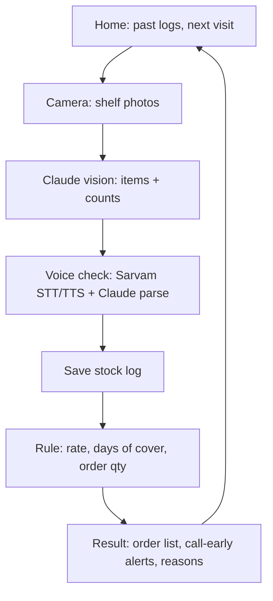

Status: draft (waiting for OK)

# KiranaQ: stock log by photo and voice, then a reorder list

Builds on the idea spec `~/repos/pm-brain/specs/2026-11-22-kirana-reorder-notebook/spec.md`. That spec asked the owner "what ran out, what was left?" This spec replaces the guess with a real count: the owner takes a photo of the shelf, a vision model counts, and the owner corrects the count by voice. The rest of the idea (transparent rule, reason line, voice in Hindi, named config) stays.

Build window: 22 Nov 2026, now until the 5:00 PM submit lock. Scope is cut to fit.

## 1. Why

A kirana owner has no POS and no bills. He orders by gut feel when the distributor's salesperson visits, so fast items run out and slow items pile up. KiranaQ lets him take a **stock log** in under a minute (photo plus a short voice check). From two or more logs the app knows how fast each item sells, how many days of stock are left, and what to order at the next visit. When an item will run out before the next visit, the app tells him to call the distributor early.

## 2. The story

1. **Home.** The owner opens the app. He sees his past stock logs: date, number of items, and items that are low. A banner shows "Next distributor visit: Tue 24 Nov (in 2 days)".
2. **Take a stock log.** He taps "Take stock log". The camera opens. He takes one or more photos of the shelf.
3. **The vision model counts.** The server sends each photo to Claude vision with the store's item list. It returns items it can see and a count for each, with a confidence.
4. **Voice check.** The app reads the counts back in Hindi (text to speech): "Maggi 12, Parle-G 30, chini 4 kilo. Sahi hai?" The owner answers by voice: "Maggi 8 hai, aur Surf bhi 5 hai". Sarvam turns speech into text. Claude turns text into edits `{item, count}`. The app shows "I heard: Maggi 8, Surf 5. Correct?" and applies the edits on yes. Items not in the photo can be added by voice or by tap. Plus and minus buttons always work too.
5. **Save the log.** The log is saved with today's date.
6. **Compute.** For each item, the server compares this log with the last one: stock then, plus what arrived, minus stock now, gives what sold. Sold divided by days gives a daily rate. Stock now divided by rate gives **days of cover**.
7. **Result screen.** For each item: stock now, rate per day, days of cover, and the suggested order quantity for the next visit, with a one-line reason ("Maggi: 1.5/day, 5 days left, visit in 2 days → order 2 cases"). Items that run out before the next visit are on top in red with "Call distributor early".
8. **Order.** The owner confirms the order quantities (plus/minus). At the next log the app assumes the order arrived, unless he says it did not.

## 3. Requirements

- **R1. Stock log history.** Home shows all past logs, newest first, with date, item count and low-stock count. Tap a log to see its counts.
- **R2. Photo count.** The owner takes 1–3 photos. The server returns a list of `{item_id, count, confidence}` that uses only items in the store catalog. Unknown objects are dropped. When the vision call fails, the owner gets an empty list and can count by voice or tap (no crash).
- **R3. Voice check.** The app speaks the counts in Hindi or English. The owner speaks corrections. The app shows what it understood and applies it only after yes. When the item or number is unclear (low confidence or unknown item), the app asks again and does not guess.
- **R4. Manual edit.** Every count has plus and minus buttons and a remove button. Voice is never the only way.
- **R5. Rate and days of cover.** For each item with a previous log: `sold = prev_count + received − count_now`, `rate = sold ÷ days`, smoothed with the old rate. `days_of_cover = count_now ÷ rate`. When `count_now = 0`, the rate is raised by the stock-out step-up (true demand is hidden).
- **R6. Order suggestion.** `order_qty = roundup_to_pack(rate × (days_to_next_visit + cycle_days) × SAFETY_MARGIN − count_now)`, never below 0. Example: rate 1.5/day, next visit in 2 days, cycle 7 days, safety 1.15, stock 5 → `1.5 × 9 × 1.15 − 5 = 10.5` → pack 6 → 12.
- **R7. Call-early alert.** When `days_of_cover < days_to_next_visit`, the item shows "Call distributor early: runs out in N days, visit in M days". Home shows the count of such items.
- **R8. Reason line.** Every suggested quantity has a one-line reason in the owner's language.
- **R9. Distribution cycle config.** The store has `cycle_days` (default 7) and `last_visit_date`. Next visit = last visit + cycle. The owner can change both in a settings screen.
- **R10. Named config.** All numbers in the rule (`SAFETY_MARGIN`, `STOCKOUT_STEP_UP`, `RATE_SMOOTHING`, default `cycle_days`, `MIN_CONFIDENCE`) live in `server/src/core/config.js`. No number is hard-coded in the rule.
- **R11. Demo seed.** One command loads a synthetic store with ~25 items and 3 past logs, so rates and alerts show at once.
- **R12. Runs on a phone.** The UI works on a phone-size screen inside the Android shell, or in a phone browser over HTTPS.

Out of scope: bills, prices, cash budget, distributor integration, login, multi-store, real owner data. Stretch only: the 12-cycle simulation chart from the idea spec, Kannada.

## 4. Design

### Architecture (copied from KidQueue, kept light)

- `server/`: Node 22, Express, better-sqlite3. One process. Serves the API and the built web UI. All model calls live in `server/src/ai/` (the only place with network I/O to models). The rule lives in `server/src/core/` (pure functions, no I/O).
- `web/`: React + Vite + Tailwind, mobile first, built into `server/public`.
- `shell/`: a minimal Kotlin WebView app (one activity). It loads the server URL and grants camera and microphone to the page. This is the KidQueue idea (thin native host, web UI from the server) without its 2000 lines of kiosk code.

**Secure context.** Browser microphone access (`getUserMedia`) needs HTTPS or `localhost`. Camera photo upload (`<input type=file capture>`) does not. For the demo: run `cloudflared tunnel --url http://localhost:3000` and point the shell (or the phone browser) at the HTTPS URL. Fallback: the laptop browser on `localhost` in phone-size view, and a text box for the voice transcript.

### Models

| Job | Model | Where |
|---|---|---|
| Count items in a photo | Claude vision (`claude-sonnet-5-5`), JSON output | `ai/vision.js` |
| Speech to text (hi-IN, en-IN) | Sarvam speech to text | `ai/sarvam.js` |
| Text to speech | Sarvam text to speech | `ai/sarvam.js` |
| Spoken text → edits JSON | Claude (`claude-haiku-5-5`), JSON output | `ai/parse.js` |

Exact Sarvam model names and endpoints come from the credits docs (open question 1). Keys come from env vars only.

Vision prompt gets the store catalog (id, names in en/hi, pack) and must answer only with `[{item_id, count, confidence}]`. The server validates: known `item_id`, integer count 0–999, confidence 0–1. Counts from a crowded shelf are rough; the voice check is there to fix them.

### Data model (SQLite)

- `store`: id, name (synthetic), language, cycle_days, last_visit_date
- `item`: id, name_en, name_hi, group, pack_size, unit, active
- `stock_log`: id, store_id, taken_at, source (`photo` | `manual`)
- `stock_count`: log_id, item_id, count, source (`vision` | `voice` | `tap`), vision_confidence
- `order_line`: log_id, item_id, suggested_qty, final_qty, received (bool, default true)
- `item_state`: item_id, rate_per_day, updated_at

### API

- `GET /api/store`, `PUT /api/store` (cycle_days, last_visit_date, language)
- `GET /api/items`
- `GET /api/logs`, `GET /api/logs/:id`
- `POST /api/vision/count` (multipart images) → draft counts
- `POST /api/voice/stt` (multipart audio) → text; `POST /api/voice/tts` (text, lang) → audio
- `POST /api/voice/parse` (text, current draft) → `{edits:[{item_id, count}], unclear:bool, ask?:string}`
- `POST /api/logs` (final counts) → saves log, runs rule, returns result
- `PUT /api/logs/:id/order` (final order qty)

### The rule (`core/rule.js`, pure)

For each active item, given previous count `p`, received `r` (last `final_qty` if `received`), current count `c`, days `d` since last log, old rate `o`:

1. `sold = max(p + r − c, 0)`
2. `observed = sold ÷ d`; if `c = 0` then `observed × (1 + STOCKOUT_STEP_UP)`
3. `rate = o is null ? observed : RATE_SMOOTHING × observed + (1 − RATE_SMOOTHING) × o`
4. `days_of_cover = rate > 0 ? c ÷ rate : Infinity`
5. `need = rate × (days_to_next_visit + cycle_days) × SAFETY_MARGIN − c`
6. `order_qty = roundup_to_pack(max(need, 0))`
7. `call_early = days_of_cover < days_to_next_visit`
8. `reason`: built from a template per case (ran out / low / about right / no history).

First log of an item (no history): no rate, no order suggestion, reason "first log, need one more".

### Screens

Home (logs + next visit + call-early count) → Camera/photo → Count review (list, plus/minus, mic button, read-back dialog) → Result (order list, alerts, reasons, confirm) → Settings (cycle, last visit, language).

## 5. Verification

| Req | Check |
|---|---|
| R1 | Manual: seed, open Home, 3 logs shown newest first |
| R2 | Live: photo of a real shelf returns known items only; unit test: validator drops unknown ids and bad counts; kill key → empty list, no crash |
| R3 | 5 Hindi + 3 English spoken phrases parse right or re-ask; unclear phrase re-asks |
| R4 | Manual walk through on phone-size view |
| R5, R6, R7 | `node --test`: worked example in R6, stock-out case, first-log case, call-early case |
| R8 | Manual: every row has a reason |
| R9 | Change cycle to 3 days, result changes |
| R10 | `rg -n "[0-9]" server/src/core/rule.js` shows only 0 and 1 |
| R11 | `pnpm seed` then Home shows rates and at least one alert |
| R12 | Screenshot from the shell or phone browser |

## 6. Open questions (proposed answers)

1. **Sarvam model names.** Proposal: Alaf reads them from the credits docs now; until then assume `saarika` (STT) and `bulbul` (TTS) on `api.sarvam.ai`.
2. **"Distribution cycle 750 days"** in the voice note is likely "7 days". Proposal: default `cycle_days = 7`, editable.
3. **Received quantity.** Proposal: assume the last confirmed order arrived in full; one toggle per log "order did not arrive".
4. **Demo device.** Proposal: Android shell over a cloudflared HTTPS URL; fallback laptop browser.
5. **Simulation chart.** Proposal: stretch only, after the live flow works.

Assumptions: starter catalog and seed are synthetic; photo counts are rough and the voice check is the fix; one store only.

## 7. Security review (manual)

The `spec-security-review` skill is not installed, so this is a short manual check.

- **Secrets:** `ANTHROPIC_API_KEY`, `SARVAM_API_KEY` in `.env` only; `.env` in `.gitignore`; never logged.
- **Personal data:** none stored. Synthetic store. No login.
- **Photos and audio:** sent to Anthropic and Sarvam for processing, not stored on disk after the request (multer memory storage). Use our own test shelf photos and voices only.
- **Model output:** treated as data. JSON is schema-validated (known ids, number ranges) before use; never executed.
- **Network:** the HTTPS tunnel exposes the demo server publicly while it runs. No auth, so stop the tunnel after the demo and use synthetic data only.
- **Tenant isolation:** one store; every query still filters by `store_id` so a second store cannot leak.
- **Findings:** 0 blocking. 1 open: the public tunnel has no auth (accepted for the demo, stop it after).
