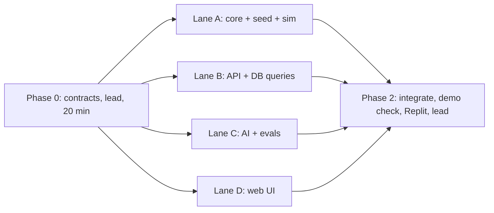

# Tasks

Written so that 4 agents (sessions) can build at the same time without touching the same files. Now ≈ 2:45 PM, submit by 5:00 PM.

Clock plan: Phase 0 2:50–3:10. Lanes 3:10–4:10 (hard stop; Lane A commits the 4 pure core files by 3:40 so Lane B can run full-flow tests). Integrate and deploy 4:10–4:45. Buffer to 5:00.

## How the work is split

1. **Phase 0 (lead, this session, ~20 min).** Write the shared contracts so every lane can start on its own: schema, config, function signatures with stubs, route files, the fake AI, the reason keys, and every server dependency. Commit. Nothing else starts before this commit.
2. **Phase 1 (4 lanes in parallel, ~75 min).** Each lane owns a set of files and only edits those. If a lane needs a change in a file it does not own, it messages the lead and does not edit the file.
3. **Phase 2 (lead, ~35 min).** Merge the lanes, run all tests, `demo:check`, deploy to Replit, walk through on the phone, record evidence.

All lanes work in the same checkout on `main` (files do not overlap), commit only their own files with `git add <paths>`, and never run `git add -A`. If a commit fails on `index.lock`, wait a few seconds and try again. Each lane ticks its own tasks in this file only in its own section.

## Phase 0: contracts (lead)

- [ ] P0.1 `server/package.json`: add every server dependency now (`@anthropic-ai/sdk`; `multer`, `sarvamai`, `dotenv` are already there) and scripts `seed`, `demo:check`, `smoke:live`, `eval:parse`, `eval:vision`, `eval:voice`, `eval:sim`, `eval:restock`. Lanes do not edit `package.json`.
- [ ] P0.2 `server/src/migrations.js`: migration 1 with the full schema from spec section "Data model".
- [ ] P0.3 `server/src/core/config.js`: every named constant from the spec (rule, restock, limits, model names, timeouts). `server/src/config.js` keeps paths, port and host only.
- [ ] P0.4 `server/src/core/reasons.js`: `REASON_KEYS` list and the args each key takes.
- [ ] P0.5 Stubs with JSDoc signatures that throw `not implemented`, with the exact input and output shapes from spec "The rule > Contracts": `core/rule.js` `computeItem({p, c, d, o, rose, pack_size, cycle_days, days_to_next_visit})`, `core/schedule.js` `nextVisit(lastVisitDate, cycleDays, today)`, `core/plan.js` `buildCards(lines, distributors)`, `core/restock.js` `findDeliveryCandidates(rows)`.
- [ ] P0.6 `server/src/app.js` `createApp({db, ai, clock, publicDir?})` (replaces `createApp(db, opts)`; update `server.js` and `test/health.test.js` to the new signature and the `{ok, db, keys}` health shape): middleware (`req.storeId = 1`, JSON, errors), mounts `routes/store.js`, `routes/logs.js` (stub routers) and the existing `routes/speech.js`, serves `public/` with SPA fallback. `server.js` wires real `db`, `ai`, `clock` (`Asia/Kolkata` date) and listens.
- [ ] P0.7 `server/src/ai/index.js` interface (`countItems`, `stt`, `tts`, `parseEdits`) and `server/src/ai/fake.js` (fixed answers for tests and `demo:check`).
- [ ] P0.7b `server/src/repo/items.js` `listItems(db, storeId)` and `server/src/repo/aiCalls.js` `logAiCall(db, storeId, row)`, real and small, so Lane C needs no SQL from Lane B.
- [ ] P0.8 `web/src/contract.js`: JSDoc shapes for `card` and `line` copied from the spec, plus one `web/src/mock/result.json` (2 cards). Lane D fills the other mocks.
- [ ] P0.9 `server/.env` has keys (Sarvam done; Anthropic: Alaf). Skeleton deploy to Replit at ~3:30 (see spec open question 4). Commit "chore: contracts for parallel lanes".

## Lane A: core rule, seed, simulation (agent 1)

Owns: `server/src/core/rule.js`, `schedule.js`, `plan.js`, `restock.js`, `server/seed/catalog.json` (not `server/data/`, git ignores it), `server/scripts/seed.js`, `server/test/{rule,schedule,plan,restock,config,reasons,seed}.test.js`, `evals/sim/`, `evals/restock/`.
Reads, never edits: `core/config.js`, `core/reasons.js`, `migrations.js`.

- [ ] A1. `rule.js` + `rule.test.js` (R6 example, stock-out, first log, smoothing, rate 0, `d = 0`, `rose`, pack rounding, 4-day vs 15-day). (R5, R6, R10) Do A1–A3 first and commit by 3:40.
- [ ] A2. `schedule.js` + test; `plan.js` + test. (R7, R9)
- [ ] A3. `restock.js` + test. (R13)
- [ ] A4. `catalog.json` (~25 items, en/hi names, aliases, group, unit, pack, distributor key) and `seed.js` (idempotent, `--reset`, dates relative to today: 1 store, 3 distributors at 4/7/15 days, 3 past logs with results from `core/`, 1 visit; its own INSERTs) + `seed.test.js`. The server runs the seed on start when the store table is empty. (R11) Coordinate brand list with Lane C's web photos.
- [ ] A5. `config.test.js` (no numeric literals in `rule.js`) and `reasons.test.js`. (R8, R10)
- [ ] A6. `evals/sim/simulate.js` (E4: 12 cycles, SVG chart + Markdown table, no chart library). Stretch: `evals/restock/` (E5).

Done: `pnpm --dir server test` passes for Lane A files; `pnpm eval:sim` prints results.

## Lane B: API and DB queries (agent 2)

Owns: `server/src/routes/store.js`, `server/src/routes/logs.js`, `server/src/repo/*.js` (all SQL, except `repo/items.js` `listItems` and `repo/aiCalls.js` from Phase 0; Lane B may add functions to `repo/items.js`), `server/test/{api-store,api-logs,api-visits,tenant}.test.js`, `server/scripts/demo-check.js`, `evals/demo/`.
Reads, never edits: `app.js`, `core/*`, `migrations.js`. Calls core functions by their Phase 0 signatures (they throw until Lane A lands; tests for the full flow go green once A merges).

- [ ] B1. `repo/` query modules, every query takes `storeId`. (security)
- [ ] B2. `routes/store.js`: store, distributors, items + `api-store.test.js`. (R9)
- [ ] B3. `routes/logs.js`: `GET /logs`, `GET /logs/:id`, `POST /logs` (one transaction: log, counts, results, state; `p`, `d` from each item's `item_state.last_log_id`; risen items keep the old rate), `GET /logs/:id/result`, `GET /orders/latest`, `PUT /logs/:id/order` + `api-logs.test.js`. (R1, R5–R8)
- [ ] B4. `POST /logs/:id/visits` (idempotent; re-plans with the stored rate, never touches `item_state`) + `api-visits.test.js`. (R13)
- [ ] B5. `tenant.test.js` (second store never read or changed).
- [ ] B6. `scripts/demo-check.js` and `evals/demo/{today-counts,after-restock}.json`. (R11, R13)

Done: Lane B tests pass (full-flow ones once Lane A is merged); `pnpm demo:check` exits 0 after A merges.

## Lane C: AI calls and model evals (agent 3)

Owns: `server/src/ai/vision.js`, `ai/sarvam.js`, `ai/parse.js`, `ai/validate.js`, `ai/real.js` (builds the real `ai` object from `VISION_PROVIDER` / `PARSE_PROVIDER`), `server/src/routes/speech.js` (exists: `/tts`, `/stt`; add `/vision`, `/parse`), `server/test/speech.test.js`, `server/test/{validate,api-ai}.test.js`, `server/scripts/smoke-live.js`, `evals/vision/`, `evals/voice/`, `evals/run-*.js` for E1–E3.
Reads, never edits: `ai/index.js`, `ai/fake.js`, `core/config.js`, `repo/items.js`, `repo/aiCalls.js`. Keeps `speak`/`transcribe` in `ai/sarvam.js`; `real.js` maps them to `tts`/`stt`. Removes `server/sarvam-hello.js` and `server/sarvam-voice-test.js` once `smoke:live` works.

- [ ] C1. `validate.js` + `validate.test.js` (vision and parse JSON rules). (R2, R3)
- [ ] C2. `vision.js` (Sarvam `gemma4` default, Claude option; catalog in prompt, JSON only, timeout) and `parse.js` (Sarvam `sarvam-105b` default, Claude Haiku option; draft + catalog aliases in prompt, `unclear` + `ask`). Each writes an `ai_call` row through `logAiCall`. (R2, R3)
- [ ] C3. `sarvam.js`: add `keyterms` to STT; model names and limits from `core/config.js`; TTS stays `bulbul:v3` (spec open question 1). (R3)
- [ ] C4. `routes/speech.js`: add `/vision` and `/parse` (multer memory storage, size limits, `MAX_MODEL_CALLS_PER_HOUR` → 429) + `api-ai.test.js` with the fake. (R2, R3)
- [ ] C5. `smoke-live.js` (one real call each). Needs keys.
- [ ] C6. Evals: E2 `evals/voice/phrases.json` (20 phrases) + runner first; then E1: 3–5 openly licensed **Indian** shelf photos into `evals/vision/` and `web/public/samples/`, `SOURCES.md`, runner (send Lane A the brands seen by 3:30; the lead writes the truth files by reading the photos). Stretch: E3 clips.

Done: Lane C tests pass; `smoke:live` all ok; E2 and E1 numbers in `checks.md`.

## Lane D: web UI (agent 4)

Owns: everything under `web/` (including `web/package.json` for `react-router-dom` and `lucide-react`, and the mocks) except `web/src/contract.js` and `web/src/mock/result.json` (Phase 0).
Reads: `DESIGN.md`, spec sections "UI tech", "Theming", "Navigation", "Screens", "API".

- [ ] D1. Base: `tokens.css` per `DESIGN.md` + Tailwind mapping, fonts, `i18n.js` (en, hi, every reason key), router, `ui/` components, TopBar, TabBar, light and dark. (R12)
- [ ] D2. `api.js` with a `VITE_USE_MOCK=1` switch to the mock JSON, so screens work before the API.
- [ ] D3. Home (distributor strip, logs, four states). (R1, R7)
- [ ] D4. Photo step (camera input or "Use a sample photo" grid from `web/public/samples/`, resize to 1600 px, up to 3) and Check step (stepper rows, add item, mic hold-to-speak with `MediaRecorder`, read-back sheet, text fallback). (R2, R3, R4)
- [ ] D5. Visit sheet, Result / Orders (cards per distributor, confirm, stamp, Read out, Copy list). (R6–R8, R13)
- [ ] D6. Settings (distributors edit, items, language, theme; no reset button). (R9) Cut first if late: keep read-only lists.

Done: `pnpm --dir web build` passes; walk through on mock data works at 390 px wide in light and dark; screenshots in the spec folder.

## Phase 2: integrate (lead)

- [ ] I1. Pull lanes together, `pnpm --dir server test` all green, `pnpm --dir web build`.
- [ ] I2. Web against the real API (mock off); fix contract gaps.
- [ ] I3. `pnpm demo:check` exits 0; `pnpm smoke:live` ok.
- [ ] I4. Deploy to Replit (build web, start server, Secrets, seed when DB empty). Phone test: photo and mic. (R12)
- [ ] I5. Evidence: `checks.md` (tests, demo check, eval numbers), screenshots, eval chart. `Status: done`.
- [ ] I6. Demo run through. Alaf submits before 5:00 PM.

Cut order if late: D6 Settings editing, E1 photos down to 2, TTS read-out (text only), E4 chart (table only), Replit (demo on laptop). E3 and E5 are stretch already. Never cut: photo count, voice edit, rule, reason line, runs-out alert, demo check.
